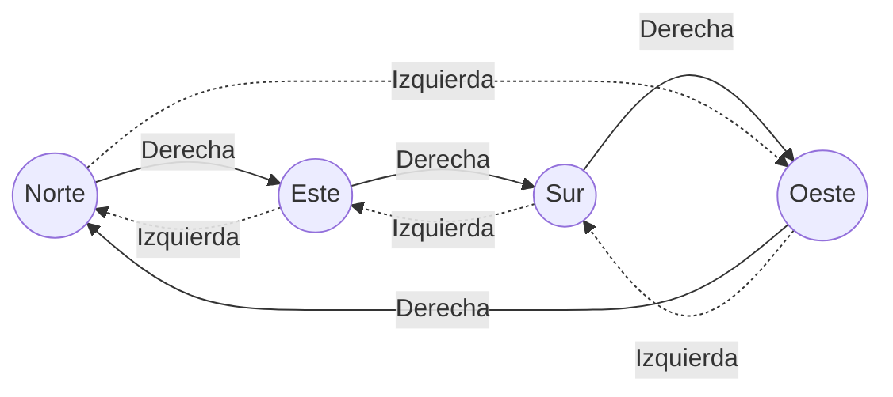
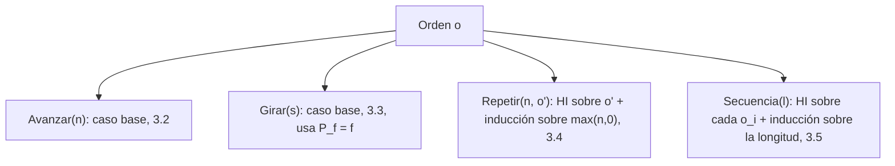
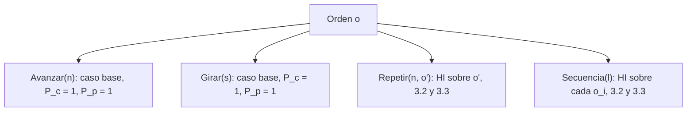
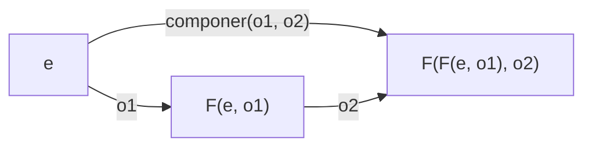

# Informe de corrección — Punto 1: `girar`

Fundamentos de Programación Funcional y Concurrente.
Taller 2 — Un robot en la cuadrícula.

## 1. El programa

```scala
def girar(d: Direccion, s: Sentido): Direccion = (d, s) match {
  case (Norte, Derecha)   => Este
  case (Norte, Izquierda) => Oeste
  case (Oeste, Derecha)   => Norte
  case (Oeste, Izquierda) => Sur
  case (Sur, Derecha)     => Oeste
  case (Sur, Izquierda)   => Este
  case (Este, Derecha)    => Sur
  case (Este, Izquierda)  => Norte
}
```

Sea $P_f$ = `girar`. El programa no es recursivo: hace un único `match` sobre
la pareja $(d, s)$ y devuelve un valor. Los tipos `Direccion` y `Sentido`
solo tienen constructores constantes (todos son *casos base*), así que no hay
hipótesis de inducción que usar: la inducción estructural se reduce a revisar
cada valor básico, es decir, a un **análisis por casos exhaustivo**.

## 2. La especificación

Para decir qué debe calcular `girar` sin depender del código, numeramos las
direcciones en el sentido de las agujas del reloj y le damos a cada sentido un
desplazamiento:

```math
\text{idx}(\text{Norte}) = 0,\quad \text{idx}(\text{Este}) = 1,\quad \text{idx}(\text{Sur}) = 2,\quad \text{idx}(\text{Oeste}) = 3
```

```math
\delta(\text{Derecha}) = +1, \qquad \delta(\text{Izquierda}) = -1
```

Girar noventa grados es avanzar (o retroceder) una posición en ese ciclo de
cuatro. La función que se quiere calcular es
$f : \text{Direccion} \times \text{Sentido} \to \text{Direccion}$:

```math
f(d, s) = \text{idx}^{-1}\big((\text{idx}(d) + \delta(s)) \bmod 4\big)
```

donde $\bmod$ devuelve siempre un valor en $\{0, 1, 2, 3\}$ (así
$-1 \bmod 4 = 3$).



Hay que demostrar:

```math
\forall d \in \text{Direccion},\ \forall s \in \text{Sentido} : P_f(d, s) == f(d, s)
```

## 3. Demostración

### 3.1 El `match` es exhaustivo y sin solapamientos

El dominio es finito:

```math
|\text{Direccion} \times \text{Sentido}| = 4 \times 2 = 8
```

El `match` tiene exactamente 8 casos, cada uno con una pareja de constantes
distinta, y no hay comodines (`_`). Entonces cada pareja $(d, s)$ coincide con
**uno y solo un** caso. Como `Direccion` y `Sentido` son `sealed trait`, el
compilador de Scala lo verifica: si faltara una pareja, avisaría que el
`match` no es exhaustivo. Por lo tanto $P_f$ es total: para toda entrada
devuelve un valor y nunca lanza `MatchError`.

### 3.2 Cada caso coincide con la especificación

Usamos el modelo de sustitución en cada uno de los 8 casos base.

**Caso $(\text{Norte}, \text{Derecha})$**

```math
P_f(\text{Norte}, \text{Derecha}) \rightarrow (\text{Norte}, \text{Derecha}) \text{ match } \{\ldots\} \rightarrow \text{Este}
```

```math
f(\text{Norte}, \text{Derecha}) = \text{idx}^{-1}((0 + 1) \bmod 4) = \text{idx}^{-1}(1) = \text{Este}
```

Entonces $P_f(\text{Norte}, \text{Derecha}) == f(\text{Norte}, \text{Derecha})$.

**Caso $(\text{Norte}, \text{Izquierda})$**

```math
P_f(\text{Norte}, \text{Izquierda}) \rightarrow \text{Oeste}, \qquad f(\text{Norte}, \text{Izquierda}) = \text{idx}^{-1}((0 - 1) \bmod 4) = \text{idx}^{-1}(3) = \text{Oeste}
```

Los seis casos restantes se resuelven igual. Se resumen en la tabla:

| $(d, s)$ | $P_f(d, s)$ | $\text{idx}(d) + \delta(s)$ | $\bmod 4$ | $f(d, s)$ | ¿Iguales? |
|---|---|---|---|---|---|
| (Norte, Derecha)   | Este  | $0 + 1 = 1$  | 1 | Este  | ✔ |
| (Norte, Izquierda) | Oeste | $0 - 1 = -1$ | 3 | Oeste | ✔ |
| (Este, Derecha)    | Sur   | $1 + 1 = 2$  | 2 | Sur   | ✔ |
| (Este, Izquierda)  | Norte | $1 - 1 = 0$  | 0 | Norte | ✔ |
| (Sur, Derecha)     | Oeste | $2 + 1 = 3$  | 3 | Oeste | ✔ |
| (Sur, Izquierda)   | Este  | $2 - 1 = 1$  | 1 | Este  | ✔ |
| (Oeste, Derecha)   | Norte | $3 + 1 = 4$  | 0 | Norte | ✔ |
| (Oeste, Izquierda) | Sur   | $3 - 1 = 2$  | 2 | Sur   | ✔ |

Como los 8 casos son todos los valores del dominio (3.1) y en cada uno
$P_f(d, s) == f(d, s)$ (3.2), concluimos:

```math
\forall d \in \text{Direccion},\ \forall s \in \text{Sentido} : P_f(d, s) == f(d, s)
```

### 3.3 Terminación

$P_f$ no se llama a sí misma ni a ninguna otra función: evalúa un `match` y
devuelve una constante. Siempre termina en un solo paso.

## 4. Propiedades que se deducen de la especificación

Las pruebas del taller verifican dos propiedades. Como ya sabemos que
$P_f = f$, basta demostrarlas sobre $f$ usando aritmética módulo 4.

**Un giro y su contrario se cancelan.** Para todo $d$:

```math
f(f(d, \text{Derecha}), \text{Izquierda}) = \text{idx}^{-1}\big((\text{idx}(d) + 1 - 1) \bmod 4\big) = \text{idx}^{-1}(\text{idx}(d)) = d
```

y de forma simétrica $f(f(d, \text{Izquierda}), \text{Derecha}) = d$.
(Prueba: `girar(girar(Este, Derecha), Izquierda) == Este`.)

**Cuatro giros al mismo lado vuelven al principio.** Para todo $d$ y todo $s$,
aplicando $f$ cuatro veces:

```math
f^4(d, s) = \text{idx}^{-1}\big((\text{idx}(d) + 4\,\delta(s)) \bmod 4\big) = \text{idx}^{-1}(\text{idx}(d)) = d
```

porque $4\,\delta(s) \in \{4, -4\}$ y $\pm 4 \equiv 0 \pmod 4$.
(Pruebas: cuatro giros a la derecha desde Norte y cuatro a la izquierda desde
Sur.)

## 5. Casos de prueba propios

Además de las pruebas dadas, se agregaron cinco casos propios que, junto con
las del enunciado, cubren las 8 parejas del dominio:

| Prueba | Caso que cubre |
|---|---|
| `girar(Este, Derecha) == Sur` | (Este, Derecha) |
| `girar(Este, Izquierda) == Norte` | (Este, Izquierda) |
| `girar(Sur, Derecha) == Oeste` | (Sur, Derecha) |
| `girar(Oeste, Izquierda) == Sur` | (Oeste, Izquierda) |
| cuatro giros a la izquierda desde Sur vuelven a Sur | propiedad $f^4(d, s) = d$ |

Como el dominio tiene solo 8 elementos y todos están probados, las pruebas
son en este caso una verificación completa, no solo una muestra.

---

# Informe de corrección — Punto 2: `ejecutar`

## 1. El programa

```scala
def ejecutar(e: Estado, o: Orden): Estado = (e, o) match {
  case (Estado(x, y, mira), Girar(sentido)) => Estado(x, y, girar(mira, sentido))
  case (Estado(x, y, Norte), Avanzar(n))    => Estado(x, y + n, Norte)
  case (Estado(x, y, Sur), Avanzar(n))      => Estado(x, y - n, Sur)
  case (Estado(x, y, Oeste), Avanzar(n))    => Estado(x - n, y, Oeste)
  case (Estado(x, y, Este), Avanzar(n))     => Estado(x + n, y, Este)

  case (x, Repetir(veces, orden)) => veces match {
    case n if n <= 0 => e
    case repetir     => ejecutar(ejecutar(e, orden), Repetir(veces - 1, orden))
  }

  case (x, Secuencia(ordenes)) => ordenes match {
    case Nil              => e
    case primera :: resto => ejecutar(ejecutar(e, primera), Secuencia(resto))
  }
}
```

Sea $P_e$ = `ejecutar`. A diferencia de `girar`, este programa **sí es
recursivo**, porque el tipo `Orden` lo es: `Repetir` y `Secuencia` contienen
otras órdenes. Por eso la demostración es por **inducción estructural sobre
`Orden`**, con un caso base por cada orden básica (`Avanzar`, `Girar`) y un
caso de inducción por cada compuesta (`Repetir`, `Secuencia`).

Escribimos un estado como la tripleta $(x, y, d)$ y usamos la función $f$ del
punto 1, de la que ya se demostró que $P_f = f$.

## 2. La especificación

**Desplazamiento de cada dirección.** Avanzar un paso mirando hacia $d$ suma
a la posición el vector $\Delta(d) = (\Delta_x(d), \Delta_y(d))$:

| $d$ | $\Delta(d)$ |
|---|---|
| Norte | $(0, 1)$ |
| Este  | $(1, 0)$ |
| Sur   | $(0, -1)$ |
| Oeste | $(-1, 0)$ |

**Efecto de una orden.** La función que se quiere calcular es
$F : \text{Estado} \times \text{Orden} \to \text{Estado}$, definida sobre la
estructura de la orden. Para abreviar, $F_o$ denota la función
$e \mapsto F(e, o)$.

```math
F\big((x, y, d), \text{Avanzar}(n)\big) = \big(x + n\,\Delta_x(d),\ y + n\,\Delta_y(d),\ d\big)
```

```math
F\big((x, y, d), \text{Girar}(s)\big) = \big(x,\ y,\ f(d, s)\big)
```

```math
F\big(e, \text{Repetir}(n, o)\big) = F_o^{\,\max(n, 0)}(e)
```

```math
F\big(e, \text{Secuencia}([o_1, \ldots, o_k])\big) = (F_{o_k} \circ \cdots \circ F_{o_1})(e)
```

donde la potencia es la composición repetida:

```math
F_o^{\,0}(e) = e, \qquad F_o^{\,m+1}(e) = F_o^{\,m}\big(F_o(e)\big)
```

y la composición de la lista vacía ($k = 0$) es la identidad. En palabras:
avanzar mueve $n$ pasos en la dirección que se mira, girar solo cambia la
dirección, repetir aplica el efecto de la orden $n$ veces (ninguna si
$n \le 0$) y la secuencia aplica los efectos en orden, cada uno sobre el
estado que dejó el anterior.

Hay que demostrar:

```math
\forall o \in \text{Orden},\ \forall e \in \text{Estado} : P_e(e, o) == F(e, o)
```

## 3. Demostración

### 3.1 El `match` es exhaustivo

| Caso del `match` | Parejas que cubre |
|---|---|
| `(Estado(x, y, mira), Girar(sentido))` | todo estado con cualquier `Girar` |
| `(Estado(x, y, Norte), Avanzar(n))` … `(Estado(x, y, Este), Avanzar(n))` | todo estado con `Avanzar`, uno por cada una de las 4 direcciones |
| `(x, Repetir(veces, orden))` | todo estado con cualquier `Repetir` |
| `(x, Secuencia(ordenes))` | todo estado con cualquier `Secuencia` |

`Orden` y `Direccion` son `sealed trait`, así que el compilador confirma que
no falta ninguna combinación. Dentro de `Repetir`, el caso `n <= 0` y el
comodín `repetir` cubren todos los enteros; dentro de `Secuencia`, `Nil` y
`primera :: resto` cubren todas las listas. Nunca se lanza `MatchError`.

### 3.2 Caso base: `Avanzar(n)`

Sea $e = (x, y, d)$. Se separa según la dirección $d$; en cada caso el modelo
de sustitución elige una sola rama del `match`:

| $d$ | $P_e(e, \text{Avanzar}(n))$ | $F(e, \text{Avanzar}(n))$ | ¿Iguales? |
|---|---|---|---|
| Norte | $(x,\ y + n,\ \text{Norte})$ | $(x + n \cdot 0,\ y + n \cdot 1,\ \text{Norte})$ | ✔ |
| Sur   | $(x,\ y - n,\ \text{Sur})$   | $(x + n \cdot 0,\ y + n \cdot (-1),\ \text{Sur})$ | ✔ |
| Oeste | $(x - n,\ y,\ \text{Oeste})$ | $(x + n \cdot (-1),\ y + n \cdot 0,\ \text{Oeste})$ | ✔ |
| Este  | $(x + n,\ y,\ \text{Este})$  | $(x + n \cdot 1,\ y + n \cdot 0,\ \text{Este})$ | ✔ |

Esto vale para todo entero $n$, incluidos los negativos (el robot retrocede)
y el cero (no se mueve).

### 3.3 Caso base: `Girar(s)`

Sea $e = (x, y, d)$:

```math
P_e\big(e, \text{Girar}(s)\big) \rightarrow \text{Estado}\big(x, y, P_f(d, s)\big) = \big(x, y, f(d, s)\big) = F\big(e, \text{Girar}(s)\big)
```

La igualdad del medio es el teorema del punto 1 ($P_f = f$).

### 3.4 Caso de inducción: `Repetir(n, o)`

**Hipótesis de inducción (HI):** la orden interna $o$ cumple la propiedad,

```math
\forall e : P_e(e, o) == F(e, o)
```

El llamado de afuera se hace sobre `Repetir(veces - 1, orden)`, que **no** es
una suborden de `Repetir(n, o)`. Por eso hace falta una segunda inducción,
esta vez sobre $m = \max(n, 0)$, para demostrar:

```math
\forall m \ge 0,\ \forall n \text{ con } \max(n, 0) = m,\ \forall e : P_e\big(e, \text{Repetir}(n, o)\big) == F_o^{\,m}(e)
```

**Base, $m = 0$ (es decir, $n \le 0$).** Se toma la rama `n <= 0`:

```math
P_e\big(e, \text{Repetir}(n, o)\big) \rightarrow e = F_o^{\,0}(e)
```

**Paso, $m + 1$ (es decir, $n = m + 1 \ge 1$).** Se supone el resultado para
$m$ (HI interna) y se toma la rama `repetir`:

```math
\begin{aligned}
P_e\big(e, \text{Repetir}(n, o)\big)
  &\rightarrow P_e\big(P_e(e, o),\ \text{Repetir}(n - 1, o)\big) \\
  &= P_e\big(F_o(e),\ \text{Repetir}(n - 1, o)\big) && \text{(HI sobre } o\text{)} \\
  &= F_o^{\,m}\big(F_o(e)\big) && \text{(HI interna, pues } \max(n-1, 0) = m\text{)} \\
  &= F_o^{\,m+1}(e) && \text{(definición de potencia)}
\end{aligned}
```

Por lo tanto $P_e(e, \text{Repetir}(n, o)) == F_o^{\max(n, 0)}(e) = F(e, \text{Repetir}(n, o))$.

### 3.5 Caso de inducción: `Secuencia(l)`

**Hipótesis de inducción (HI):** cada orden $o_i$ de la lista cumple la
propiedad, $\forall e : P_e(e, o_i) == F(e, o_i)$.

Igual que en `Repetir`, el llamado de afuera es sobre `Secuencia(resto)`,
que no es una suborden; se hace una segunda inducción, sobre la longitud
$k$ de la lista, para demostrar:

```math
\forall e : P_e\big(e, \text{Secuencia}([o_1, \ldots, o_k])\big) == (F_{o_k} \circ \cdots \circ F_{o_1})(e)
```

**Base, $k = 0$.** Se toma la rama `Nil`:

```math
P_e\big(e, \text{Secuencia}(\text{Nil})\big) \rightarrow e = \text{id}(e)
```

**Paso, $k + 1$.** La lista es $o_1 :: [o_2, \ldots, o_{k+1}]$. Se supone el
resultado para listas de longitud $k$ (HI interna); como los elementos de
`resto` también están en la lista original, la HI sobre las órdenes les sigue
valiendo:

```math
\begin{aligned}
P_e\big(e, \text{Secuencia}(o_1 :: \text{resto})\big)
  &\rightarrow P_e\big(P_e(e, o_1),\ \text{Secuencia}(\text{resto})\big) \\
  &= P_e\big(F_{o_1}(e),\ \text{Secuencia}(\text{resto})\big) && \text{(HI sobre } o_1\text{)} \\
  &= (F_{o_{k+1}} \circ \cdots \circ F_{o_2})\big(F_{o_1}(e)\big) && \text{(HI interna)} \\
  &= (F_{o_{k+1}} \circ \cdots \circ F_{o_1})(e)
\end{aligned}
```

### 3.6 Conclusión



Los cuatro casos son todas las alternativas de `Orden` (3.1) y en cada uno
$P_e = F$; por el principio de inducción estructural:

```math
\forall o \in \text{Orden},\ \forall e \in \text{Estado} : P_e(e, o) == F(e, o)
```

### 3.7 Terminación

A cada orden se le asocia la pareja $\big(\text{tam}(o), c(o)\big)$, donde
$\text{tam}(o)$ cuenta los constructores de la orden (sin mirar los números)
y $c(o)$ es $\max(n, 0)$ si la orden es `Repetir(n, _)` y $0$ en otro caso.
Las parejas se comparan en orden lexicográfico. Cada llamado recursivo baja
esa medida:

| Llamado | Por qué es menor |
|---|---|
| `ejecutar(e, orden)` dentro de `Repetir` | `orden` es suborden: $\text{tam}$ baja |
| `ejecutar(_, Repetir(veces - 1, orden))` con `veces > 0` | mismo $\text{tam}$, $c$ baja de $n$ a $n - 1$ |
| `ejecutar(e, primera)` dentro de `Secuencia` | `primera` es suborden: $\text{tam}$ baja |
| `ejecutar(_, Secuencia(resto))` | la lista tiene un elemento menos: $\text{tam}$ baja |

El orden lexicográfico sobre parejas de naturales no tiene cadenas
descendentes infinitas, así que $P_e$ siempre termina.

## 4. Propiedades que se deducen de la especificación

**Las órdenes vacías no hacen nada.** Por la especificación,
$F(e, \text{Repetir}(n, o)) = F_o^{0}(e) = e$ si $n \le 0$, y
$F(e, \text{Secuencia}(\text{Nil})) = e$.
(Pruebas: repetir cero veces y la secuencia vacía.)

**El cuadrado vuelve al punto de partida.** Sea
$C = \text{Secuencia}([\text{Avanzar}(1), \text{Girar}(\text{Derecha})])$.
Por la especificación,

```math
F_C(x, y, d) = \big(x + \Delta_x(d),\ y + \Delta_y(d),\ f(d, \text{Derecha})\big)
```

Al aplicarla cuatro veces desde $(x, y, d)$ el robot mira, en orden, las
cuatro direcciones distintas $d, f(d, D), f^2(d, D), f^3(d, D)$, así que

```math
F_C^{\,4}(x, y, d) = \Big(x + \sum_{d'} \Delta_x(d'),\ y + \sum_{d'} \Delta_y(d'),\ f^4(d, \text{Derecha})\Big) = (x, y, d)
```

porque la suma de los cuatro vectores de la tabla es $(0, 0)$ y
$f^4(d, s) = d$ (punto 1). En particular
`ejecutar(inicial, cuadrado) == Estado(0, 0, Norte)`.

**Un `Repetir` dentro de otro multiplica las veces.** Para $a, b \ge 0$:

```math
F\big(e, \text{Repetir}(a, \text{Repetir}(b, o))\big) = \big(F_o^{\,b}\big)^{a}(e) = F_o^{\,a \cdot b}(e)
```

(Prueba propia: `Repetir(2, Repetir(3, Avanzar(1)))` desde el origen deja al
robot en $(0, 6, \text{Norte})$, igual que aplicar $\text{Avanzar}(1)$ seis
veces.)

## 5. Casos de prueba propios

| Prueba | Qué cubre de la demostración |
|---|---|
| `Girar(Izquierda)` desde `(2, 3, Sur)` da `(2, 3, Este)` | caso base `Girar` (3.3) desde un estado distinto del inicial |
| `Avanzar(3)` desde `(-1, 4, Este)` da `(2, 4, Este)` | caso base `Avanzar` con $d = \text{Este}$ (3.2), la rama que no cubren las pruebas dadas |
| `Repetir(2, Repetir(3, Avanzar(1)))` da `(0, 6, Norte)` | caso `Repetir` con HI sobre otro `Repetir` (3.4) y la propiedad de multiplicación (4) |
| espiral que pasa por las cuatro direcciones da `(2, -2, Este)` | caso `Secuencia` (3.5) recorriendo las cuatro ramas de `Avanzar` |
| `Secuencia([Repetir(2, Girar(Derecha)), Avanzar(5)])` da `(0, -5, Sur)` | `Repetir` dentro de `Secuencia`: la HI de 3.5 se aplica a una orden compuesta |

Junto con las pruebas dadas, se ejercitan las cuatro ramas de `Avanzar`, la
de `Girar`, las dos ramas de `Repetir` y las dos de `Secuencia`.

---

# Informe de corrección — Punto 3: `cuantasBasicas` y `profundidad`

## 1. El programa

```scala
def cuantasBasicas(o: Orden): Int = o match {
  case Avanzar(_)            => 1
  case Girar(_)              => 1
  case Repetir(veces, orden) => math.max(veces, 0) * cuantasBasicas(orden)
  case Secuencia(ordenes)    => ordenes.map(cuantasBasicas).sum
}

def profundidad(o: Orden): Int = o match {
  case Avanzar(_)         => 1
  case Girar(_)           => 1
  case Repetir(_, orden)  => 1 + profundidad(orden)
  case Secuencia(ordenes) => 1 + ordenes.map(profundidad).maxOption.getOrElse(0)
}
```

Sea $P_c$ = `cuantasBasicas` y $P_p$ = `profundidad`. Las dos son recursivas
porque `Orden` lo es, así que la demostración es por **inducción estructural
sobre `Orden`**: un caso base por `Avanzar` y otro por `Girar`, y un caso de
inducción por `Repetir` y otro por `Secuencia`.

A diferencia de `ejecutar`, aquí cada llamado recursivo (directo o a través
de `map`) se hace sobre una orden que está **dentro** de la orden original.
`Repetir` no se resuelve bajando las veces de una en una sino multiplicando,
así que no hace falta una segunda inducción.

Del comportamiento de las listas de Scala se usa solo esto:

```math
[o_1, \ldots, o_k].\text{map}(g) = [g(o_1), \ldots, g(o_k)], \qquad [a_1, \ldots, a_k].\text{sum} = \sum_{i=1}^{k} a_i
```

```math
[a_1, \ldots, a_k].\text{maxOption} = \begin{cases} \text{None} & k = 0 \\ \text{Some}(\max_i a_i) & k \ge 1 \end{cases}
```

## 2. La especificación

### 2.1 `cuantasBasicas`

El enunciado pide contar cuántos `Avanzar` y `Girar` **llega a ejecutar** la
orden. Para decirlo sin mirar el código, definimos $L(o)$, la lista de
órdenes básicas que se ejecutan al cumplir $o$, en el orden en que se
ejecutan ($+\!+$ es concatenar listas y $\ell^{m}$ es la lista $\ell$
concatenada $m$ veces, con $\ell^{0} = [\,]$):

```math
L(\text{Avanzar}(n)) = [\text{Avanzar}(n)], \qquad L(\text{Girar}(s)) = [\text{Girar}(s)]
```

```math
L(\text{Repetir}(n, o)) = L(o)^{\max(n, 0)}, \qquad L(\text{Secuencia}([o_1, \ldots, o_k])) = L(o_1) +\!+ \cdots +\!+ L(o_k)
```

Esta lista corresponde con la especificación $F$ del punto 2: como $F$ de
`Repetir` es aplicar $F_o$ $\max(n, 0)$ veces y $F$ de `Secuencia` es
componer en orden, ejecutar $o$ es aplicar una tras otra las básicas de
$L(o)$. La función que se quiere calcular es su longitud,
$\lvert L(o) \rvert$, y de la longitud se usan dos hechos:

```math
\lvert \ell_1 +\!+ \ell_2 \rvert = \lvert \ell_1 \rvert + \lvert \ell_2 \rvert, \qquad \lvert \ell^{m} \rvert = m \cdot \lvert \ell \rvert
```

### 2.2 `profundidad`

Una orden se ve como un árbol: las básicas son hojas, `Repetir` tiene un
hijo y `Secuencia` tiene un hijo por cada orden de la lista. La profundidad
es la cantidad de niveles de ese árbol, que el enunciado describe así:

```math
h(\text{Avanzar}(n)) = h(\text{Girar}(s)) = 1, \qquad h(\text{Repetir}(n, o)) = 1 + h(o)
```

```math
h(\text{Secuencia}([o_1, \ldots, o_k])) = 1 + \max\{h(o_1), \ldots, h(o_k)\}, \quad \text{con } \max \emptyset = 0
```

Hay que demostrar:

```math
\forall o \in \text{Orden} : P_c(o) == \lvert L(o) \rvert \ \wedge\ P_p(o) == h(o)
```

## 3. Demostración

### 3.1 Los `match` son exhaustivos

Cada función tiene un caso por cada una de las cuatro alternativas de
`Orden`, que es `sealed trait`, así que el compilador confirma que no falta
ninguna. En las básicas se usa `_`, que acepta cualquier número o sentido.
Además, `maxOption` no falla con la lista vacía (`max` sí lanzaría una
excepción), así que ninguna de las dos funciones lanza errores.

### 3.2 `cuantasBasicas`

**Casos base.** Por el modelo de sustitución:

```math
P_c(\text{Avanzar}(n)) \rightarrow 1 = \lvert [\text{Avanzar}(n)] \rvert = \lvert L(\text{Avanzar}(n)) \rvert
```

y de la misma forma $P_c(\text{Girar}(s)) \rightarrow 1 = \lvert L(\text{Girar}(s)) \rvert$.

**Caso de inducción `Repetir(n, o)`.** HI: $P_c(o) == \lvert L(o) \rvert$.

```math
\begin{aligned}
P_c(\text{Repetir}(n, o))
  &\rightarrow \max(n, 0) \cdot P_c(o) \\
  &= \max(n, 0) \cdot \lvert L(o) \rvert && \text{(HI)} \\
  &= \lvert L(o)^{\max(n, 0)} \rvert && \text{(longitud de } \ell^{m}\text{)} \\
  &= \lvert L(\text{Repetir}(n, o)) \rvert
\end{aligned}
```

**Caso de inducción `Secuencia([o_1, ..., o_k])`.** HI: para cada $i$,
$P_c(o_i) == \lvert L(o_i) \rvert$.

```math
\begin{aligned}
P_c(\text{Secuencia}([o_1, \ldots, o_k]))
  &\rightarrow [o_1, \ldots, o_k].\text{map}(P_c).\text{sum} \\
  &= [P_c(o_1), \ldots, P_c(o_k)].\text{sum} = \sum_{i=1}^{k} P_c(o_i) \\
  &= \sum_{i=1}^{k} \lvert L(o_i) \rvert && \text{(HI)} \\
  &= \lvert L(o_1) +\!+ \cdots +\!+ L(o_k) \rvert && \text{(longitud de } +\!+\text{)} \\
  &= \lvert L(\text{Secuencia}([o_1, \ldots, o_k])) \rvert
\end{aligned}
```

Con $k = 0$ la suma vacía es $0$ y $L(\text{Secuencia}(\text{Nil})) = [\,]$,
de longitud $0$, así que el caso también vale.

### 3.3 `profundidad`

**Casos base.** $P_p(\text{Avanzar}(n)) \rightarrow 1 = h(\text{Avanzar}(n))$,
y lo mismo para `Girar`.

**Caso de inducción `Repetir(n, o)`.** HI: $P_p(o) == h(o)$.

```math
P_p(\text{Repetir}(n, o)) \rightarrow 1 + P_p(o) = 1 + h(o) = h(\text{Repetir}(n, o))
```

**Caso de inducción `Secuencia([o_1, ..., o_k])`.** HI: para cada $i$,
$P_p(o_i) == h(o_i)$. Si $k \ge 1$:

```math
\begin{aligned}
P_p(\text{Secuencia}([o_1, \ldots, o_k]))
  &\rightarrow 1 + [P_p(o_1), \ldots, P_p(o_k)].\text{maxOption}.\text{getOrElse}(0) \\
  &= 1 + \text{Some}\big(\max_i P_p(o_i)\big).\text{getOrElse}(0) = 1 + \max_i P_p(o_i) \\
  &= 1 + \max_i h(o_i) && \text{(HI)} \\
  &= h(\text{Secuencia}([o_1, \ldots, o_k]))
\end{aligned}
```

Si $k = 0$:

```math
P_p(\text{Secuencia}(\text{Nil})) \rightarrow 1 + \text{None}.\text{getOrElse}(0) = 1 + 0 = 1 = h(\text{Secuencia}(\text{Nil}))
```

### 3.4 Conclusión



Los cuatro casos son todas las alternativas de `Orden`; por el principio de
inducción estructural:

```math
\forall o \in \text{Orden} : P_c(o) == \lvert L(o) \rvert \ \wedge\ P_p(o) == h(o)
```

### 3.5 Terminación

Sea $\text{tam}(o)$ la cantidad de constructores de la orden. Cada llamado
recursivo se hace sobre la orden de adentro de un `Repetir` o sobre un
elemento de la lista de una `Secuencia`, y las dos tienen $\text{tam}$
estrictamente menor que la orden original. Como $\text{tam}$ es un número
natural, no puede bajar para siempre: las dos funciones terminan.

Hay una diferencia con `ejecutar`: allí `Repetir(n, o)` hace $n$ rondas de
llamados, y aquí hace uno solo y multiplica. Por eso
`cuantasBasicas(Repetir(1000, C))` cuesta lo mismo que
`cuantasBasicas(Repetir(4, C))`.

## 4. Propiedades que se deducen de la especificación

**Las repeticiones anidadas se multiplican.** Para $a, b \ge 0$:

```math
\lvert L(\text{Repetir}(a, \text{Repetir}(b, o))) \rvert = a \cdot b \cdot \lvert L(o) \rvert
```

(Pruebas: `Repetir(2, Repetir(3, Girar(Derecha)))` cuenta $2 \cdot 3 = 6$, y
`Repetir(n, cuadrado)` cuenta $8n$ para $n \in \{0, 1, 2, 5, 10\}$).

**Repetir con veces negativas no ejecuta nada.** Si $n < 0$,
$\max(n, 0) = 0$ y la cuenta es $0$, igual que `ejecutar`, que con
`veces <= 0` deja el estado como estaba. (Prueba: `Repetir(-2, Avanzar(1))`).

**La profundidad no depende de las veces.** $h(\text{Repetir}(n, o)) = 1 + h(o)$
para cualquier $n$. (Prueba: `Repetir(n, cuadrado)` tiene profundidad 4 con
$n = 0, 1, 7$).

**Cada compuesta agrega exactamente un nivel, aunque esté vacía.** Por eso
`Secuencia(Nil)` dentro de otra secuencia también cuenta como nivel.
(Prueba: `Secuencia([Avanzar(1), Secuencia([Girar(I), Secuencia(Nil)])])`
tiene profundidad 3).

**Relación con `ejecutar`.** $\lvert L(o) \rvert$ es la cantidad de llamados de
`ejecutar` que caen en un caso base. En la traza del cuadrado del punto 2
son 8 de los 25 llamados, y `cuantasBasicas(cuadrado) == 8`.

## 5. Casos de prueba propios

Están en `RobotCuadriculaPunto3Test.scala`.

| Prueba | Qué cubre de la demostración |
|---|---|
| `Girar(Izquierda)` cuenta 1 | caso base `Girar` (3.2) |
| `Repetir(3, Avanzar(2))` cuenta 3 | caso `Repetir` sobre una básica |
| `Repetir(2, Repetir(3, Girar(D)))` cuenta 6 | `Repetir` con HI sobre otro `Repetir`; propiedad de multiplicación (4) |
| secuencia con un `Repetir` adentro cuenta 6 | caso `Secuencia` (3.2) sumando una compuesta |
| `Repetir(-2, Avanzar(1))` cuenta 0 | rama de $\max(n, 0) = 0$ |
| `Repetir(n, cuadrado)` cuenta $n \cdot 8$ | $\lvert \ell^{m} \rvert = m \cdot \lvert \ell \rvert$ para varios $m$ |
| `Girar(Izquierda)` tiene profundidad 1 | caso base de $h$ (3.3) |
| `Repetir(5, Avanzar(1))` tiene profundidad 2 | caso `Repetir` de $h$ |
| `Repetir(2, Repetir(3, Girar(D)))` tiene profundidad 3 | `Repetir` anidado |
| secuencia con `Secuencia(Nil)` anidada tiene profundidad 3 | rama $k = 0$ dentro de otra secuencia |
| `Repetir(2, Sec[Avanzar(1), Repetir(3, Girar(D))])` tiene profundidad 4 | el máximo escoge la rama más honda |
| `Repetir(n, cuadrado)` tiene profundidad 4 para $n = 0, 1, 7$ | la profundidad no depende de las veces (4) |

---

# Informe de corrección — Punto 4: `componer`, `rutina`, `aplicarA` y `transformar`

## 1. El programa

```scala
def componer(o1: Orden, o2: Orden): Orden = Secuencia(List(o1, o2))

def rutina(pasos: Int)(giro: Sentido)(veces: Int): Orden =
  Repetir(veces, Secuencia(List(Avanzar(pasos), Girar(giro))))

def aplicarA(estados: List[Estado], o: Orden): List[Estado] =
  estados.map(e => ejecutar(e, o))

def transformar(o: Orden, f: Orden => Orden): Orden = o match {
  case Avanzar(_)            => f(o)
  case Girar(_)              => f(o)
  case Repetir(veces, orden) => Repetir(veces, transformar(orden, f))
  case Secuencia(ordenes)    => Secuencia(ordenes.map(x => transformar(x, f)))
}
```

`componer`, `rutina` y `aplicarA` no son recursivas: se demuestran con el
modelo de sustitución y con el teorema del punto 2,

```math
\forall o,\ \forall e : P_e(e, o) == F(e, o)
```

donde $P_e$ = `ejecutar`, $F$ es su especificación y $F_o$ denota
$e \mapsto F(e, o)$. `transformar` sí es recursiva y se demuestra por
inducción estructural sobre `Orden`.

## 2. La especificación

| Función | Lo que debe cumplir |
|---|---|
| `componer(o1, o2)` | ejecutarla es ejecutar `o1` y luego `o2`: $F_{\text{componer}(o_1, o_2)} = F_{o_2} \circ F_{o_1}$ |
| `rutina(p)(g)(v)` | es repetir $v$ veces avanzar $p$ y girar hacia $g$; fijados $p$ y $g$, es una función $\mathbb{Z} \to \text{Orden}$ |
| `aplicarA([e_1, ..., e_k], o)` | $[F(e_1, o), \ldots, F(e_k, o)]$ |
| `transformar(o, f)` | $T_f(o)$, definida abajo |

$T_f$ cambia cada hoja del árbol de la orden por $f$ aplicada a esa hoja y
deja igual todo lo demás:

```math
T_f(b) = f(b) \quad \text{si } b \text{ es Avanzar o Girar}
```

```math
T_f(\text{Repetir}(n, o)) = \text{Repetir}(n, T_f(o)), \qquad T_f(\text{Secuencia}([o_1, \ldots, o_k])) = \text{Secuencia}([T_f(o_1), \ldots, T_f(o_k)])
```

Se supone que $f$ termina y devuelve una orden para cualquier orden que
reciba; las funciones de las pruebas lo cumplen porque terminan en
`case otra => otra`.

## 3. Demostración

### 3.1 `componer`: la rutina compuesta equivale a ejecutar sus partes

Sea $e' = P_e(e, o_1)$. Siguiendo el código de `ejecutar` con el modelo de
sustitución:

```math
\begin{aligned}
P_e(e, \text{componer}(o_1, o_2))
  &\rightarrow P_e\big(e, \text{Secuencia}([o_1, o_2])\big) \\
  &\rightarrow P_e\big(P_e(e, o_1),\ \text{Secuencia}([o_2])\big) = P_e\big(e',\ \text{Secuencia}([o_2])\big) && (\texttt{primera :: resto}) \\
  &\rightarrow P_e\big(P_e(e', o_2),\ \text{Secuencia}(\text{Nil})\big) && (\texttt{primera :: resto}) \\
  &\rightarrow P_e(e', o_2) = P_e\big(P_e(e, o_1),\ o_2\big) && (\texttt{Nil})
\end{aligned}
```

Y por el teorema del punto 2 aplicado dos veces:

```math
P_e(e, \text{componer}(o_1, o_2)) = F\big(F(e, o_1), o_2\big) = (F_{o_2} \circ F_{o_1})(e)
```

Es decir, ejecutar la orden compuesta deja al robot en el mismo estado que
ejecutar la primera parte y, desde ahí, la segunda.



**Consecuencias.**

* *Agrupar distinto no cambia el efecto.* Como la composición de funciones
  es asociativa,

```math
F_{\text{componer}(\text{componer}(a, b), c)} = F_c \circ (F_b \circ F_a) = (F_c \circ F_b) \circ F_a = F_{\text{componer}(a, \text{componer}(b, c))}
```

  aunque las dos órdenes son distintas, porque `componer` no aplana las
  secuencias.

* *El orden sí importa.* $F_{o_2} \circ F_{o_1}$ en general no es
  $F_{o_1} \circ F_{o_2}$: `componer(Girar(D), Avanzar(3))` deja al robot en
  $(3, 0, \text{Este})$ y `componer(Avanzar(3), Girar(D))` en
  $(0, 3, \text{Este})$.

* *Lo que mide el punto 3.* Como
  $L(\text{componer}(o_1, o_2)) = L(o_1) +\!+ L(o_2)$, las básicas de la
  compuesta son la suma de las de las partes, y su profundidad es
  $1 + \max(h(o_1), h(o_2))$.

### 3.2 `rutina`

Con los tres argumentos, por sustitución:

```math
\text{rutina}(p)(g)(v) \rightarrow \text{Repetir}\big(v,\ \text{Secuencia}([\text{Avanzar}(p), \text{Girar}(g)])\big) = \text{Repetir}\big(v,\ \text{componer}(\text{Avanzar}(p), \text{Girar}(g))\big)
```

**Currificación.** Con solo los dos primeros, `rutina(p)(g) _` es la
función

```math
v \mapsto \text{Repetir}\big(v,\ \text{componer}(\text{Avanzar}(p), \text{Girar}(g))\big) \quad : \quad \text{Int} \Rightarrow \text{Orden}
```

que no construye nada hasta que recibe $v$, y se puede usar con distintas
veces sin volver a dar $p$ ni $g$.

**La rutina equivale a repetir sus partes.** Sea
$K = \text{componer}(\text{Avanzar}(p), \text{Girar}(g))$. Por el punto 2
(caso `Repetir`) y por 3.1:

```math
F(e, \text{rutina}(p)(g)(v)) = F_K^{\,\max(v, 0)}(e), \qquad F_K = F_{\text{Girar}(g)} \circ F_{\text{Avanzar}(p)}
```

**El cuadrado de cualquier lado vuelve al principio.** Con la notación del
punto 2:

```math
F_K(x, y, d) = \big(x + p\,\Delta_x(d),\ y + p\,\Delta_y(d),\ f(d, g)\big)
```

Al aplicar $F_K$ cuatro veces el robot mira, en orden,
$d, f(d, g), f^2(d, g), f^3(d, g)$, que son las cuatro direcciones
distintas porque $f(\cdot, g)$ recorre el ciclo de cuatro del punto 1. Entonces

```math
F_K^{\,4}(x, y, d) = \Big(x + p \sum_{d'} \Delta_x(d'),\ y + p \sum_{d'} \Delta_y(d'),\ f^4(d, g)\Big) = (x, y, d)
```

porque la suma de los cuatro vectores $\Delta$ es $(0, 0)$ y $f^4(d, g) = d$.
Vale para todo estado, todo $p$ y los dos sentidos.
(Pruebas: el cuadrado de lado 2 vuelve al origen; `cuadradoDe(4)`).

**Básicas.** $\lvert L(\text{rutina}(p)(g)(v)) \rvert = 2\max(v, 0)$.
(Prueba: `rutina(5)(Derecha)(6)` cuenta 12).

### 3.3 `aplicarA`

Por sustitución:

```math
P_a([e_1, \ldots, e_k], o) \rightarrow [e_1, \ldots, e_k].\text{map}(e \mapsto P_e(e, o)) = [P_e(e_1, o), \ldots, P_e(e_k, o)]
```

y por el teorema del punto 2 eso es $[F(e_1, o), \ldots, F(e_k, o)]$, que es
la especificación. `map` produce una lista del mismo tamaño y en el mismo
orden, y cada elemento depende solo de su propio estado. De ahí:

* $P_a(\text{Nil}, o) = \text{Nil}$ y $P_a([e], o) = [P_e(e, o)]$.
* Si $F_o$ es la identidad (el cuadrado, `Secuencia(Nil)`), la lista sale
  igual a como entró.

### 3.4 `transformar`

Sea $P_t$ = `transformar`. Hay que demostrar
$\forall o : P_t(o, f) == T_f(o)$.

**Casos base.** Si $b$ es `Avanzar` o `Girar`:
$P_t(b, f) \rightarrow f(b) = T_f(b)$.

**Caso de inducción `Repetir(n, o)`.** HI: $P_t(o, f) == T_f(o)$.

```math
P_t(\text{Repetir}(n, o), f) \rightarrow \text{Repetir}(n, P_t(o, f)) = \text{Repetir}(n, T_f(o)) = T_f(\text{Repetir}(n, o))
```

**Caso de inducción `Secuencia([o_1, ..., o_k])`.** HI: para cada $i$,
$P_t(o_i, f) == T_f(o_i)$.

```math
\begin{aligned}
P_t(\text{Secuencia}([o_1, \ldots, o_k]), f)
  &\rightarrow \text{Secuencia}\big([o_1, \ldots, o_k].\text{map}(x \mapsto P_t(x, f))\big) \\
  &= \text{Secuencia}([P_t(o_1, f), \ldots, P_t(o_k, f)]) \\
  &= \text{Secuencia}([T_f(o_1), \ldots, T_f(o_k)]) && \text{(HI)} \\
  &= T_f(\text{Secuencia}([o_1, \ldots, o_k]))
\end{aligned}
```

Con $k = 0$ queda `Secuencia(Nil)` en los dos lados. Por inducción
estructural, $\forall o : P_t(o, f) == T_f(o)$.

**Terminación.** Los llamados recursivos son sobre órdenes de adentro, con
$\text{tam}$ menor, igual que en el punto 3. A $f$ se la llama una sola vez
por cada hoja y su resultado no se vuelve a recorrer. Por eso, aunque $f$
devuelva una compuesta, no hay ciclos. (Prueba: con
$f(o) = \text{Repetir}(2, o)$, `transformar(Avanzar(2), f)` da
`Repetir(2, Avanzar(2))` y no se sigue anidando).

## 4. Propiedades que se deducen de la especificación

**Con la identidad no cambia nada.** $T_{\text{id}}(o) = o$. Por inducción:
en las hojas $\text{id}(b) = b$; en `Repetir`,
$\text{Repetir}(n, T_{\text{id}}(o)) = \text{Repetir}(n, o)$ por HI, y lo
mismo en cada elemento de `Secuencia`.

**Si $f$ lleva básicas en básicas, la forma se conserva.** Para todo $o$:

```math
\lvert L(T_f(o)) \rvert = \lvert L(o) \rvert, \qquad h(T_f(o)) = h(o)
```

Por inducción: en una hoja, $f(b)$ es básica, así que cuenta 1 y tiene
profundidad 1, igual que $b$. En `Repetir` las veces son las mismas y, por
HI, la orden de adentro cuenta lo mismo y tiene la misma profundidad. En
`Secuencia` se suman y se toma el máximo de valores iguales por HI.

**`transformar` respeta `componer` y `rutina`.** Por sustitución:

```math
T_f(\text{componer}(a, b)) = T_f(\text{Secuencia}([a, b])) = \text{componer}(T_f(a), T_f(b))
```

y con `doblar` (`Avanzar(n)` pasa a `Avanzar(2n)`, lo demás queda igual):

```math
T_{\text{doblar}}(\text{rutina}(p)(g)(v)) = \text{Repetir}\big(v,\ \text{Secuencia}([\text{Avanzar}(2p), \text{Girar}(g)])\big) = \text{rutina}(2p)(g)(v)
```

En particular `transformar(cuadrado, doblar) == rutina(2)(Derecha)(4)`, el
cuadrado de lado 2, que por 3.2 también vuelve al origen.

## 5. Casos de prueba propios

Están en `RobotCuadriculaPunto4Test.scala`.

| Prueba | Qué cubre de la demostración |
|---|---|
| `componer(Girar(I), Avanzar(3))` da `Sec[Girar(I), Avanzar(3)]` | definición de `componer` con el giro primero |
| `componer` no aplana una secuencia que ya trae | la compuesta es exactamente `Secuencia([o1, o2])` |
| las básicas de `componer(cuadrado, Avanzar(7))` son $8 + 1$ | $L(\text{componer}) = L(o_1) +\!+ L(o_2)$ (3.1) |
| `componer(Avanzar(1), cuadrado)` tiene profundidad 4 | $1 + \max(h(o_1), h(o_2))$ (3.1) |
| `componer(Girar(D), Avanzar(3))` lleva a $(3, 0, \text{Este})$ | $F_{o_2} \circ F_{o_1}$; el orden importa (3.1) |
| `rutina(2)(Izquierda)(3)` arma la repetición | sustitución en `rutina` (3.2) |
| `rutina(0)(Derecha)(2)` deja `Avanzar(0)` adentro | `pasos` se copia sin cambios |
| `rutina(3)(Izquierda) _` sirve con 1 y con 5 veces | currificación (3.2) |
| `rutina(5)(Derecha)(6)` cuenta 12 | $2\max(v, 0)$ (3.2) |
| `rutina(2)(Derecha)(4)` vuelve al origen | $F_K^{\,4} = \text{id}$ con $p = 2$ (3.2) |
| `rutina(4)(Izquierda)(0)` deja el estado igual | $F_K^{\,0} = \text{id}$ |
| `aplicarA` con un giro cambia solo la dirección | `map` con el caso `Girar` (3.3) |
| `aplicarA` conserva el orden de la lista | `map` mantiene posiciones (3.3) |
| `aplicarA` con el cuadrado deja cada estado igual | $F_{\text{cuadrado}} = \text{id}$ para todo estado |
| `aplicarA([e], o) == [ejecutar(e, o)]` | caso de un solo estado (3.3) |
| `aplicarA` con `Secuencia(Nil)` devuelve los mismos estados | $F_{\text{Secuencia(Nil)}} = \text{id}$ |
| `transformar` con `alReves` cambia los giros | casos base y `Secuencia` (3.4) |
| `transformar(Avanzar(3), triple)` da `Avanzar(9)` | caso base: $T_f(b) = f(b)$ |
| `transformar` llega a `Repetir` anidados | caso `Repetir` con HI sobre otro `Repetir` |
| `transformar` con `triple` conserva cuenta y profundidad | la forma se conserva (4) |
| $f(o) = \text{Repetir}(2, o)$ se aplica una sola vez | terminación: no se recorre el resultado de $f$ (3.4) |
| triplicar los avances de `Sec[Avanzar(2), Avanzar(1)]` lleva a $(0, 9, \text{Norte})$ | $T_f$ junto con $F$ del punto 2 |
