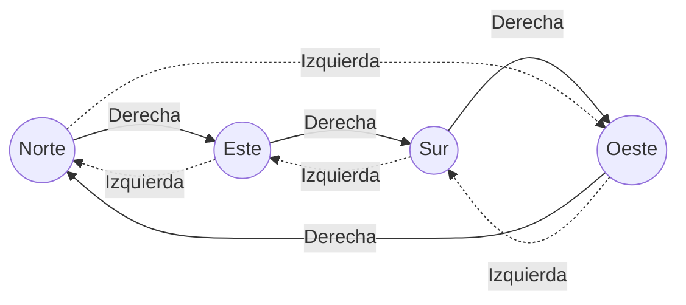
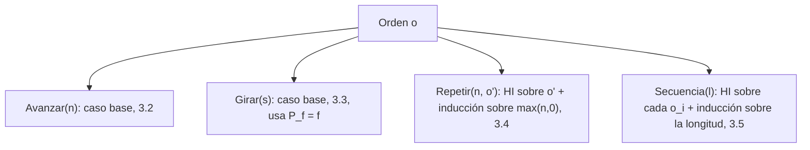

# Informe de corrección — Punto 1: `girar`

Fundamentos de Programación Funcional y Concurrente.
Taller 2 — Un robot en la cuadrícula.

## 1. El programa

```scala
def girar(d: Direccion, s: Sentido): Direccion = (d, s) match {
  case (Norte, Derecha)   => Este
  case (Norte, Izquierda) => Oeste
  case (Oeste, Derecha)   => Norte
  case (Oeste, Izquierda) => Sur
  case (Sur, Derecha)     => Oeste
  case (Sur, Izquierda)   => Este
  case (Este, Derecha)    => Sur
  case (Este, Izquierda)  => Norte
}
```

Sea $P_f$ = `girar`. El programa no es recursivo: hace un único `match` sobre
la pareja $(d, s)$ y devuelve un valor. Los tipos `Direccion` y `Sentido`
solo tienen constructores constantes (todos son *casos base*), así que no hay
hipótesis de inducción que usar: la inducción estructural se reduce a revisar
cada valor básico, es decir, a un **análisis por casos exhaustivo**.

## 2. La especificación

Para decir qué debe calcular `girar` sin depender del código, numeramos las
direcciones en el sentido de las agujas del reloj y le damos a cada sentido un
desplazamiento:

```math
\text{idx}(\text{Norte}) = 0,\quad \text{idx}(\text{Este}) = 1,\quad \text{idx}(\text{Sur}) = 2,\quad \text{idx}(\text{Oeste}) = 3
```

```math
\delta(\text{Derecha}) = +1, \qquad \delta(\text{Izquierda}) = -1
```

Girar noventa grados es avanzar (o retroceder) una posición en ese ciclo de
cuatro. La función que se quiere calcular es
$f : \text{Direccion} \times \text{Sentido} \to \text{Direccion}$:

```math
f(d, s) = \text{idx}^{-1}\big((\text{idx}(d) + \delta(s)) \bmod 4\big)
```

donde $\bmod$ devuelve siempre un valor en $\{0, 1, 2, 3\}$ (así
$-1 \bmod 4 = 3$).



Hay que demostrar:

```math
\forall d \in \text{Direccion},\ \forall s \in \text{Sentido} : P_f(d, s) == f(d, s)
```

## 3. Demostración

### 3.1 El `match` es exhaustivo y sin solapamientos

El dominio es finito:

```math
|\text{Direccion} \times \text{Sentido}| = 4 \times 2 = 8
```

El `match` tiene exactamente 8 casos, cada uno con una pareja de constantes
distinta, y no hay comodines (`_`). Entonces cada pareja $(d, s)$ coincide con
**uno y solo un** caso. Como `Direccion` y `Sentido` son `sealed trait`, el
compilador de Scala lo verifica: si faltara una pareja, avisaría que el
`match` no es exhaustivo. Por lo tanto $P_f$ es total: para toda entrada
devuelve un valor y nunca lanza `MatchError`.

### 3.2 Cada caso coincide con la especificación

Usamos el modelo de sustitución en cada uno de los 8 casos base.

**Caso $(\text{Norte}, \text{Derecha})$**

```math
P_f(\text{Norte}, \text{Derecha}) \rightarrow (\text{Norte}, \text{Derecha}) \text{ match } \{\ldots\} \rightarrow \text{Este}
```

```math
f(\text{Norte}, \text{Derecha}) = \text{idx}^{-1}((0 + 1) \bmod 4) = \text{idx}^{-1}(1) = \text{Este}
```

Entonces $P_f(\text{Norte}, \text{Derecha}) == f(\text{Norte}, \text{Derecha})$.

**Caso $(\text{Norte}, \text{Izquierda})$**

```math
P_f(\text{Norte}, \text{Izquierda}) \rightarrow \text{Oeste}, \qquad f(\text{Norte}, \text{Izquierda}) = \text{idx}^{-1}((0 - 1) \bmod 4) = \text{idx}^{-1}(3) = \text{Oeste}
```

Los seis casos restantes se resuelven igual. Se resumen en la tabla:

| $(d, s)$ | $P_f(d, s)$ | $\text{idx}(d) + \delta(s)$ | $\bmod 4$ | $f(d, s)$ | ¿Iguales? |
|---|---|---|---|---|---|
| (Norte, Derecha)   | Este  | $0 + 1 = 1$  | 1 | Este  | ✔ |
| (Norte, Izquierda) | Oeste | $0 - 1 = -1$ | 3 | Oeste | ✔ |
| (Este, Derecha)    | Sur   | $1 + 1 = 2$  | 2 | Sur   | ✔ |
| (Este, Izquierda)  | Norte | $1 - 1 = 0$  | 0 | Norte | ✔ |
| (Sur, Derecha)     | Oeste | $2 + 1 = 3$  | 3 | Oeste | ✔ |
| (Sur, Izquierda)   | Este  | $2 - 1 = 1$  | 1 | Este  | ✔ |
| (Oeste, Derecha)   | Norte | $3 + 1 = 4$  | 0 | Norte | ✔ |
| (Oeste, Izquierda) | Sur   | $3 - 1 = 2$  | 2 | Sur   | ✔ |

Como los 8 casos son todos los valores del dominio (3.1) y en cada uno
$P_f(d, s) == f(d, s)$ (3.2), concluimos:

```math
\forall d \in \text{Direccion},\ \forall s \in \text{Sentido} : P_f(d, s) == f(d, s)
```

### 3.3 Terminación

$P_f$ no se llama a sí misma ni a ninguna otra función: evalúa un `match` y
devuelve una constante. Siempre termina en un solo paso.

## 4. Propiedades que se deducen de la especificación

Las pruebas del taller verifican dos propiedades. Como ya sabemos que
$P_f = f$, basta demostrarlas sobre $f$ usando aritmética módulo 4.

**Un giro y su contrario se cancelan.** Para todo $d$:

```math
f(f(d, \text{Derecha}), \text{Izquierda}) = \text{idx}^{-1}\big((\text{idx}(d) + 1 - 1) \bmod 4\big) = \text{idx}^{-1}(\text{idx}(d)) = d
```

y de forma simétrica $f(f(d, \text{Izquierda}), \text{Derecha}) = d$.
(Prueba: `girar(girar(Este, Derecha), Izquierda) == Este`.)

**Cuatro giros al mismo lado vuelven al principio.** Para todo $d$ y todo $s$,
aplicando $f$ cuatro veces:

```math
f^4(d, s) = \text{idx}^{-1}\big((\text{idx}(d) + 4\,\delta(s)) \bmod 4\big) = \text{idx}^{-1}(\text{idx}(d)) = d
```

porque $4\,\delta(s) \in \{4, -4\}$ y $\pm 4 \equiv 0 \pmod 4$.
(Pruebas: cuatro giros a la derecha desde Norte y cuatro a la izquierda desde
Sur.)

## 5. Casos de prueba propios

Además de las pruebas dadas, se agregaron cinco casos propios que, junto con
las del enunciado, cubren las 8 parejas del dominio:

| Prueba | Caso que cubre |
|---|---|
| `girar(Este, Derecha) == Sur` | (Este, Derecha) |
| `girar(Este, Izquierda) == Norte` | (Este, Izquierda) |
| `girar(Sur, Derecha) == Oeste` | (Sur, Derecha) |
| `girar(Oeste, Izquierda) == Sur` | (Oeste, Izquierda) |
| cuatro giros a la izquierda desde Sur vuelven a Sur | propiedad $f^4(d, s) = d$ |

Como el dominio tiene solo 8 elementos y todos están probados, las pruebas
son en este caso una verificación completa, no solo una muestra.

---

# Informe de corrección — Punto 2: `ejecutar`

## 1. El programa

```scala
def ejecutar(e: Estado, o: Orden): Estado = (e, o) match {
  case (Estado(x, y, mira), Girar(sentido)) => Estado(x, y, girar(mira, sentido))
  case (Estado(x, y, Norte), Avanzar(n))    => Estado(x, y + n, Norte)
  case (Estado(x, y, Sur), Avanzar(n))      => Estado(x, y - n, Sur)
  case (Estado(x, y, Oeste), Avanzar(n))    => Estado(x - n, y, Oeste)
  case (Estado(x, y, Este), Avanzar(n))     => Estado(x + n, y, Este)

  case (x, Repetir(veces, orden)) => veces match {
    case n if n <= 0 => e
    case repetir     => ejecutar(ejecutar(e, orden), Repetir(veces - 1, orden))
  }

  case (x, Secuencia(ordenes)) => ordenes match {
    case Nil              => e
    case primera :: resto => ejecutar(ejecutar(e, primera), Secuencia(resto))
  }
}
```

Sea $P_e$ = `ejecutar`. A diferencia de `girar`, este programa **sí es
recursivo**, porque el tipo `Orden` lo es: `Repetir` y `Secuencia` contienen
otras órdenes. Por eso la demostración es por **inducción estructural sobre
`Orden`**, con un caso base por cada orden básica (`Avanzar`, `Girar`) y un
caso de inducción por cada compuesta (`Repetir`, `Secuencia`).

Escribimos un estado como la tripleta $(x, y, d)$ y usamos la función $f$ del
punto 1, de la que ya se demostró que $P_f = f$.

## 2. La especificación

**Desplazamiento de cada dirección.** Avanzar un paso mirando hacia $d$ suma
a la posición el vector $\Delta(d) = (\Delta_x(d), \Delta_y(d))$:

| $d$ | $\Delta(d)$ |
|---|---|
| Norte | $(0, 1)$ |
| Este  | $(1, 0)$ |
| Sur   | $(0, -1)$ |
| Oeste | $(-1, 0)$ |

**Efecto de una orden.** La función que se quiere calcular es
$F : \text{Estado} \times \text{Orden} \to \text{Estado}$, definida sobre la
estructura de la orden. Para abreviar, $F_o$ denota la función
$e \mapsto F(e, o)$.

```math
F\big((x, y, d), \text{Avanzar}(n)\big) = \big(x + n\,\Delta_x(d),\ y + n\,\Delta_y(d),\ d\big)
```

```math
F\big((x, y, d), \text{Girar}(s)\big) = \big(x,\ y,\ f(d, s)\big)
```

```math
F\big(e, \text{Repetir}(n, o)\big) = F_o^{\,\max(n, 0)}(e)
```

```math
F\big(e, \text{Secuencia}([o_1, \ldots, o_k])\big) = (F_{o_k} \circ \cdots \circ F_{o_1})(e)
```

donde la potencia es la composición repetida:

```math
F_o^{\,0}(e) = e, \qquad F_o^{\,m+1}(e) = F_o^{\,m}\big(F_o(e)\big)
```

y la composición de la lista vacía ($k = 0$) es la identidad. En palabras:
avanzar mueve $n$ pasos en la dirección que se mira, girar solo cambia la
dirección, repetir aplica el efecto de la orden $n$ veces (ninguna si
$n \le 0$) y la secuencia aplica los efectos en orden, cada uno sobre el
estado que dejó el anterior.

Hay que demostrar:

```math
\forall o \in \text{Orden},\ \forall e \in \text{Estado} : P_e(e, o) == F(e, o)
```

## 3. Demostración

### 3.1 El `match` es exhaustivo

| Caso del `match` | Parejas que cubre |
|---|---|
| `(Estado(x, y, mira), Girar(sentido))` | todo estado con cualquier `Girar` |
| `(Estado(x, y, Norte), Avanzar(n))` … `(Estado(x, y, Este), Avanzar(n))` | todo estado con `Avanzar`, uno por cada una de las 4 direcciones |
| `(x, Repetir(veces, orden))` | todo estado con cualquier `Repetir` |
| `(x, Secuencia(ordenes))` | todo estado con cualquier `Secuencia` |

`Orden` y `Direccion` son `sealed trait`, así que el compilador confirma que
no falta ninguna combinación. Dentro de `Repetir`, el caso `n <= 0` y el
comodín `repetir` cubren todos los enteros; dentro de `Secuencia`, `Nil` y
`primera :: resto` cubren todas las listas. Nunca se lanza `MatchError`.

### 3.2 Caso base: `Avanzar(n)`

Sea $e = (x, y, d)$. Se separa según la dirección $d$; en cada caso el modelo
de sustitución elige una sola rama del `match`:

| $d$ | $P_e(e, \text{Avanzar}(n))$ | $F(e, \text{Avanzar}(n))$ | ¿Iguales? |
|---|---|---|---|
| Norte | $(x,\ y + n,\ \text{Norte})$ | $(x + n \cdot 0,\ y + n \cdot 1,\ \text{Norte})$ | ✔ |
| Sur   | $(x,\ y - n,\ \text{Sur})$   | $(x + n \cdot 0,\ y + n \cdot (-1),\ \text{Sur})$ | ✔ |
| Oeste | $(x - n,\ y,\ \text{Oeste})$ | $(x + n \cdot (-1),\ y + n \cdot 0,\ \text{Oeste})$ | ✔ |
| Este  | $(x + n,\ y,\ \text{Este})$  | $(x + n \cdot 1,\ y + n \cdot 0,\ \text{Este})$ | ✔ |

Esto vale para todo entero $n$, incluidos los negativos (el robot retrocede)
y el cero (no se mueve).

### 3.3 Caso base: `Girar(s)`

Sea $e = (x, y, d)$:

```math
P_e\big(e, \text{Girar}(s)\big) \rightarrow \text{Estado}\big(x, y, P_f(d, s)\big) = \big(x, y, f(d, s)\big) = F\big(e, \text{Girar}(s)\big)
```

La igualdad del medio es el teorema del punto 1 ($P_f = f$).

### 3.4 Caso de inducción: `Repetir(n, o)`

**Hipótesis de inducción (HI):** la orden interna $o$ cumple la propiedad,

```math
\forall e : P_e(e, o) == F(e, o)
```

El llamado de afuera se hace sobre `Repetir(veces - 1, orden)`, que **no** es
una suborden de `Repetir(n, o)`. Por eso hace falta una segunda inducción,
esta vez sobre $m = \max(n, 0)$, para demostrar:

```math
\forall m \ge 0,\ \forall n \text{ con } \max(n, 0) = m,\ \forall e : P_e\big(e, \text{Repetir}(n, o)\big) == F_o^{\,m}(e)
```

**Base, $m = 0$ (es decir, $n \le 0$).** Se toma la rama `n <= 0`:

```math
P_e\big(e, \text{Repetir}(n, o)\big) \rightarrow e = F_o^{\,0}(e)
```

**Paso, $m + 1$ (es decir, $n = m + 1 \ge 1$).** Se supone el resultado para
$m$ (HI interna) y se toma la rama `repetir`:

```math
\begin{aligned}
P_e\big(e, \text{Repetir}(n, o)\big)
  &\rightarrow P_e\big(P_e(e, o),\ \text{Repetir}(n - 1, o)\big) \\
  &= P_e\big(F_o(e),\ \text{Repetir}(n - 1, o)\big) && \text{(HI sobre } o\text{)} \\
  &= F_o^{\,m}\big(F_o(e)\big) && \text{(HI interna, pues } \max(n-1, 0) = m\text{)} \\
  &= F_o^{\,m+1}(e) && \text{(definición de potencia)}
\end{aligned}
```

Por lo tanto $P_e(e, \text{Repetir}(n, o)) == F_o^{\max(n, 0)}(e) = F(e, \text{Repetir}(n, o))$.

### 3.5 Caso de inducción: `Secuencia(l)`

**Hipótesis de inducción (HI):** cada orden $o_i$ de la lista cumple la
propiedad, $\forall e : P_e(e, o_i) == F(e, o_i)$.

Igual que en `Repetir`, el llamado de afuera es sobre `Secuencia(resto)`,
que no es una suborden; se hace una segunda inducción, sobre la longitud
$k$ de la lista, para demostrar:

```math
\forall e : P_e\big(e, \text{Secuencia}([o_1, \ldots, o_k])\big) == (F_{o_k} \circ \cdots \circ F_{o_1})(e)
```

**Base, $k = 0$.** Se toma la rama `Nil`:

```math
P_e\big(e, \text{Secuencia}(\text{Nil})\big) \rightarrow e = \text{id}(e)
```

**Paso, $k + 1$.** La lista es $o_1 :: [o_2, \ldots, o_{k+1}]$. Se supone el
resultado para listas de longitud $k$ (HI interna); como los elementos de
`resto` también están en la lista original, la HI sobre las órdenes les sigue
valiendo:

```math
\begin{aligned}
P_e\big(e, \text{Secuencia}(o_1 :: \text{resto})\big)
  &\rightarrow P_e\big(P_e(e, o_1),\ \text{Secuencia}(\text{resto})\big) \\
  &= P_e\big(F_{o_1}(e),\ \text{Secuencia}(\text{resto})\big) && \text{(HI sobre } o_1\text{)} \\
  &= (F_{o_{k+1}} \circ \cdots \circ F_{o_2})\big(F_{o_1}(e)\big) && \text{(HI interna)} \\
  &= (F_{o_{k+1}} \circ \cdots \circ F_{o_1})(e)
\end{aligned}
```

### 3.6 Conclusión



Los cuatro casos son todas las alternativas de `Orden` (3.1) y en cada uno
$P_e = F$; por el principio de inducción estructural:

```math
\forall o \in \text{Orden},\ \forall e \in \text{Estado} : P_e(e, o) == F(e, o)
```

### 3.7 Terminación

A cada orden se le asocia la pareja $\big(\text{tam}(o), c(o)\big)$, donde
$\text{tam}(o)$ cuenta los constructores de la orden (sin mirar los números)
y $c(o)$ es $\max(n, 0)$ si la orden es `Repetir(n, _)` y $0$ en otro caso.
Las parejas se comparan en orden lexicográfico. Cada llamado recursivo baja
esa medida:

| Llamado | Por qué es menor |
|---|---|
| `ejecutar(e, orden)` dentro de `Repetir` | `orden` es suborden: $\text{tam}$ baja |
| `ejecutar(_, Repetir(veces - 1, orden))` con `veces > 0` | mismo $\text{tam}$, $c$ baja de $n$ a $n - 1$ |
| `ejecutar(e, primera)` dentro de `Secuencia` | `primera` es suborden: $\text{tam}$ baja |
| `ejecutar(_, Secuencia(resto))` | la lista tiene un elemento menos: $\text{tam}$ baja |

El orden lexicográfico sobre parejas de naturales no tiene cadenas
descendentes infinitas, así que $P_e$ siempre termina.

## 4. Propiedades que se deducen de la especificación

**Las órdenes vacías no hacen nada.** Por la especificación,
$F(e, \text{Repetir}(n, o)) = F_o^{0}(e) = e$ si $n \le 0$, y
$F(e, \text{Secuencia}(\text{Nil})) = e$.
(Pruebas: repetir cero veces y la secuencia vacía.)

**El cuadrado vuelve al punto de partida.** Sea
$C = \text{Secuencia}([\text{Avanzar}(1), \text{Girar}(\text{Derecha})])$.
Por la especificación,

```math
F_C(x, y, d) = \big(x + \Delta_x(d),\ y + \Delta_y(d),\ f(d, \text{Derecha})\big)
```

Al aplicarla cuatro veces desde $(x, y, d)$ el robot mira, en orden, las
cuatro direcciones distintas $d, f(d, D), f^2(d, D), f^3(d, D)$, así que

```math
F_C^{\,4}(x, y, d) = \Big(x + \sum_{d'} \Delta_x(d'),\ y + \sum_{d'} \Delta_y(d'),\ f^4(d, \text{Derecha})\Big) = (x, y, d)
```

porque la suma de los cuatro vectores de la tabla es $(0, 0)$ y
$f^4(d, s) = d$ (punto 1). En particular
`ejecutar(inicial, cuadrado) == Estado(0, 0, Norte)`.

**Un `Repetir` dentro de otro multiplica las veces.** Para $a, b \ge 0$:

```math
F\big(e, \text{Repetir}(a, \text{Repetir}(b, o))\big) = \big(F_o^{\,b}\big)^{a}(e) = F_o^{\,a \cdot b}(e)
```

(Prueba propia: `Repetir(2, Repetir(3, Avanzar(1)))` desde el origen deja al
robot en $(0, 6, \text{Norte})$, igual que aplicar $\text{Avanzar}(1)$ seis
veces.)

## 5. Casos de prueba propios

| Prueba | Qué cubre de la demostración |
|---|---|
| `Girar(Izquierda)` desde `(2, 3, Sur)` da `(2, 3, Este)` | caso base `Girar` (3.3) desde un estado distinto del inicial |
| `Avanzar(3)` desde `(-1, 4, Este)` da `(2, 4, Este)` | caso base `Avanzar` con $d = \text{Este}$ (3.2), la rama que no cubren las pruebas dadas |
| `Repetir(2, Repetir(3, Avanzar(1)))` da `(0, 6, Norte)` | caso `Repetir` con HI sobre otro `Repetir` (3.4) y la propiedad de multiplicación (4) |
| espiral que pasa por las cuatro direcciones da `(2, -2, Este)` | caso `Secuencia` (3.5) recorriendo las cuatro ramas de `Avanzar` |
| `Secuencia([Repetir(2, Girar(Derecha)), Avanzar(5)])` da `(0, -5, Sur)` | `Repetir` dentro de `Secuencia`: la HI de 3.5 se aplica a una orden compuesta |

Junto con las pruebas dadas, se ejercitan las cuatro ramas de `Avanzar`, la
de `Girar`, las dos ramas de `Repetir` y las dos de `Secuencia`.
