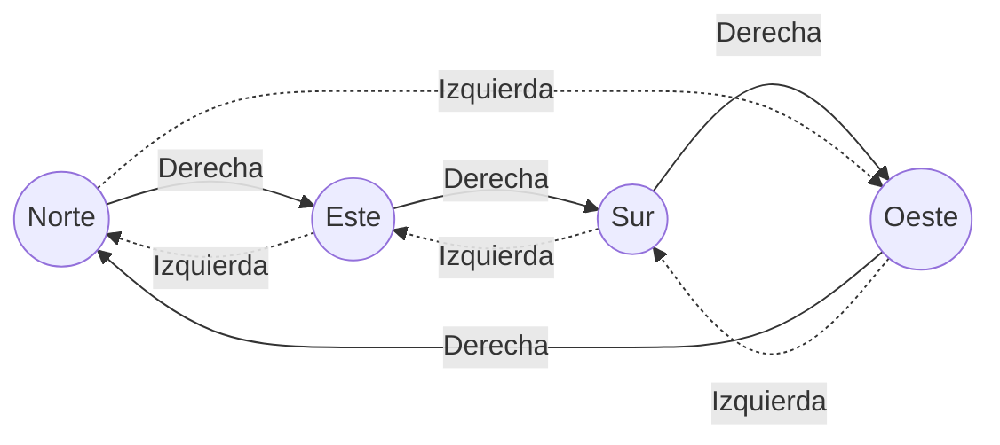

# Informe de corrección — Punto 1: `girar`

Fundamentos de Programación Funcional y Concurrente.
Taller 2 — Un robot en la cuadrícula.

## 1. El programa

```scala
def girar(d: Direccion, s: Sentido): Direccion = (d, s) match {
  case (Norte, Derecha)   => Este
  case (Norte, Izquierda) => Oeste
  case (Oeste, Derecha)   => Norte
  case (Oeste, Izquierda) => Sur
  case (Sur, Derecha)     => Oeste
  case (Sur, Izquierda)   => Este
  case (Este, Derecha)    => Sur
  case (Este, Izquierda)  => Norte
}
```

Sea $P_f$ = `girar`. El programa no es recursivo: hace un único `match` sobre
la pareja $(d, s)$ y devuelve un valor. Los tipos `Direccion` y `Sentido`
solo tienen constructores constantes (todos son *casos base*), así que no hay
hipótesis de inducción que usar: la inducción estructural se reduce a revisar
cada valor básico, es decir, a un **análisis por casos exhaustivo**.

## 2. La especificación

Para decir qué debe calcular `girar` sin depender del código, numeramos las
direcciones en el sentido de las agujas del reloj y le damos a cada sentido un
desplazamiento:

```math
\text{idx}(\text{Norte}) = 0,\quad \text{idx}(\text{Este}) = 1,\quad \text{idx}(\text{Sur}) = 2,\quad \text{idx}(\text{Oeste}) = 3
```

```math
\delta(\text{Derecha}) = +1, \qquad \delta(\text{Izquierda}) = -1
```

Girar noventa grados es avanzar (o retroceder) una posición en ese ciclo de
cuatro. La función que se quiere calcular es
$f : \text{Direccion} \times \text{Sentido} \to \text{Direccion}$:

```math
f(d, s) = \text{idx}^{-1}\big((\text{idx}(d) + \delta(s)) \bmod 4\big)
```

donde $\bmod$ devuelve siempre un valor en $\{0, 1, 2, 3\}$ (así
$-1 \bmod 4 = 3$).



Hay que demostrar:

```math
\forall d \in \text{Direccion},\ \forall s \in \text{Sentido} : P_f(d, s) == f(d, s)
```

## 3. Demostración

### 3.1 El `match` es exhaustivo y sin solapamientos

El dominio es finito:

```math
|\text{Direccion} \times \text{Sentido}| = 4 \times 2 = 8
```

El `match` tiene exactamente 8 casos, cada uno con una pareja de constantes
distinta, y no hay comodines (`_`). Entonces cada pareja $(d, s)$ coincide con
**uno y solo un** caso. Como `Direccion` y `Sentido` son `sealed trait`, el
compilador de Scala lo verifica: si faltara una pareja, avisaría que el
`match` no es exhaustivo. Por lo tanto $P_f$ es total: para toda entrada
devuelve un valor y nunca lanza `MatchError`.

### 3.2 Cada caso coincide con la especificación

Usamos el modelo de sustitución en cada uno de los 8 casos base.

**Caso $(\text{Norte}, \text{Derecha})$**

```math
P_f(\text{Norte}, \text{Derecha}) \rightarrow (\text{Norte}, \text{Derecha}) \text{ match } \{\ldots\} \rightarrow \text{Este}
```

```math
f(\text{Norte}, \text{Derecha}) = \text{idx}^{-1}((0 + 1) \bmod 4) = \text{idx}^{-1}(1) = \text{Este}
```

Entonces $P_f(\text{Norte}, \text{Derecha}) == f(\text{Norte}, \text{Derecha})$.

**Caso $(\text{Norte}, \text{Izquierda})$**

```math
P_f(\text{Norte}, \text{Izquierda}) \rightarrow \text{Oeste}, \qquad f(\text{Norte}, \text{Izquierda}) = \text{idx}^{-1}((0 - 1) \bmod 4) = \text{idx}^{-1}(3) = \text{Oeste}
```

Los seis casos restantes se resuelven igual. Se resumen en la tabla:

| $(d, s)$ | $P_f(d, s)$ | $\text{idx}(d) + \delta(s)$ | $\bmod 4$ | $f(d, s)$ | ¿Iguales? |
|---|---|---|---|---|---|
| (Norte, Derecha)   | Este  | $0 + 1 = 1$  | 1 | Este  | ✔ |
| (Norte, Izquierda) | Oeste | $0 - 1 = -1$ | 3 | Oeste | ✔ |
| (Este, Derecha)    | Sur   | $1 + 1 = 2$  | 2 | Sur   | ✔ |
| (Este, Izquierda)  | Norte | $1 - 1 = 0$  | 0 | Norte | ✔ |
| (Sur, Derecha)     | Oeste | $2 + 1 = 3$  | 3 | Oeste | ✔ |
| (Sur, Izquierda)   | Este  | $2 - 1 = 1$  | 1 | Este  | ✔ |
| (Oeste, Derecha)   | Norte | $3 + 1 = 4$  | 0 | Norte | ✔ |
| (Oeste, Izquierda) | Sur   | $3 - 1 = 2$  | 2 | Sur   | ✔ |

Como los 8 casos son todos los valores del dominio (3.1) y en cada uno
$P_f(d, s) == f(d, s)$ (3.2), concluimos:

```math
\forall d \in \text{Direccion},\ \forall s \in \text{Sentido} : P_f(d, s) == f(d, s)
```

### 3.3 Terminación

$P_f$ no se llama a sí misma ni a ninguna otra función: evalúa un `match` y
devuelve una constante. Siempre termina en un solo paso.

## 4. Propiedades que se deducen de la especificación

Las pruebas del taller verifican dos propiedades. Como ya sabemos que
$P_f = f$, basta demostrarlas sobre $f$ usando aritmética módulo 4.

**Un giro y su contrario se cancelan.** Para todo $d$:

```math
f(f(d, \text{Derecha}), \text{Izquierda}) = \text{idx}^{-1}\big((\text{idx}(d) + 1 - 1) \bmod 4\big) = \text{idx}^{-1}(\text{idx}(d)) = d
```

y de forma simétrica $f(f(d, \text{Izquierda}), \text{Derecha}) = d$.
(Prueba: `girar(girar(Este, Derecha), Izquierda) == Este`.)

**Cuatro giros al mismo lado vuelven al principio.** Para todo $d$ y todo $s$,
aplicando $f$ cuatro veces:

```math
f^4(d, s) = \text{idx}^{-1}\big((\text{idx}(d) + 4\,\delta(s)) \bmod 4\big) = \text{idx}^{-1}(\text{idx}(d)) = d
```

porque $4\,\delta(s) \in \{4, -4\}$ y $\pm 4 \equiv 0 \pmod 4$.
(Pruebas: cuatro giros a la derecha desde Norte y cuatro a la izquierda desde
Sur.)

## 5. Casos de prueba propios

Además de las pruebas dadas, se agregaron cinco casos propios que, junto con
las del enunciado, cubren las 8 parejas del dominio:

| Prueba | Caso que cubre |
|---|---|
| `girar(Este, Derecha) == Sur` | (Este, Derecha) |
| `girar(Este, Izquierda) == Norte` | (Este, Izquierda) |
| `girar(Sur, Derecha) == Oeste` | (Sur, Derecha) |
| `girar(Oeste, Izquierda) == Sur` | (Oeste, Izquierda) |
| cuatro giros a la izquierda desde Sur vuelven a Sur | propiedad $f^4(d, s) = d$ |

Como el dominio tiene solo 8 elementos y todos están probados, las pruebas
son en este caso una verificación completa, no solo una muestra.
