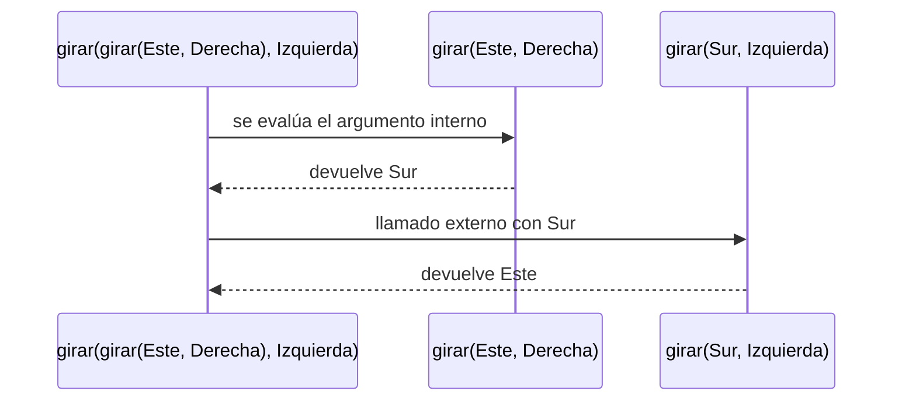
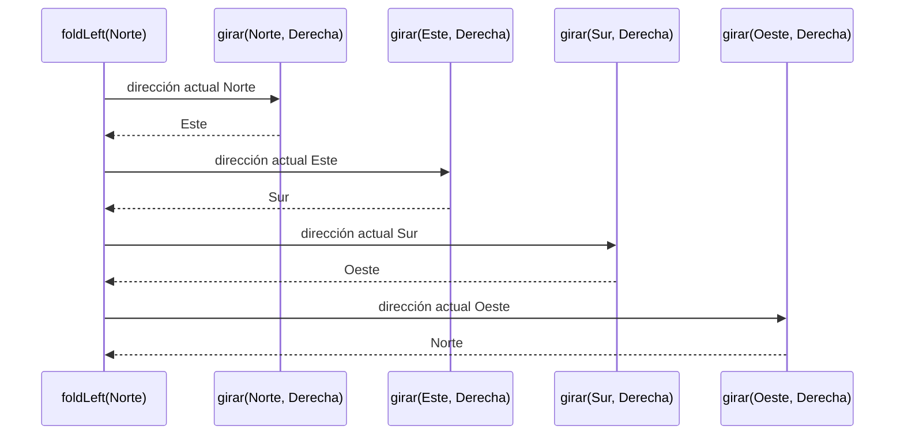
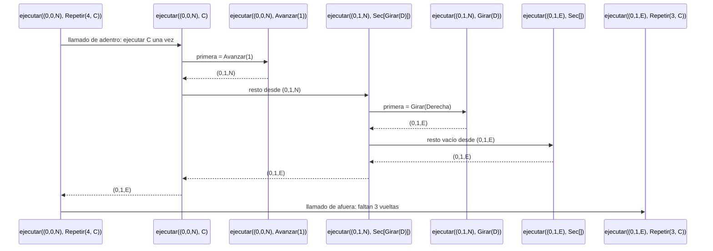
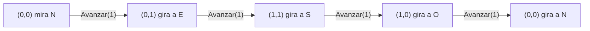

# Informe de proceso — Punto 1: `girar`

## Definición de la función

```scala
def girar(d: Direccion, s: Sentido): Direccion = (d, s) match {
  case (Norte, Derecha)   => Este
  case (Norte, Izquierda) => Oeste
  case (Oeste, Derecha)   => Norte
  case (Oeste, Izquierda) => Sur
  case (Sur, Derecha)     => Oeste
  case (Sur, Izquierda)   => Este
  case (Este, Derecha)    => Sur
  case (Este, Izquierda)  => Norte
}
```

* La función recibe la dirección a la que mira el robot (`d`) y el sentido del
  giro (`s`), y devuelve la nueva dirección.
* Arma la pareja `(d, s)` y la compara con los casos del `match`.
* Scala revisa los casos **de arriba hacia abajo** y se queda con el primero
  que coincide. Como hay un caso por cada una de las 8 parejas posibles,
  siempre encuentra uno.
* No es recursiva: no se llama a sí misma, así que cada llamado ocupa un solo
  marco en la pila y termina enseguida.

---

## Ejemplo 1: `girar(Norte, Derecha)`

### Paso 1: Llamada inicial

```scala
girar(Norte, Derecha)
```

### Paso 2: Se arma la pareja

```scala
(Norte, Derecha) match { ... }
```

### Paso 3: Se revisan los casos

```scala
case (Norte, Derecha) => Este   // coincide en el primer caso
```

### Paso 4: Resultado

```scala
Este
```

---

## Ejemplo 2: `girar(Sur, Izquierda)`

Este ejemplo muestra cómo el `match` va descartando casos hasta encontrar el
que coincide.

| Caso revisado | ¿Coincide con `(Sur, Izquierda)`? |
|---|---|
| `(Norte, Derecha)`   | no |
| `(Norte, Izquierda)` | no |
| `(Oeste, Derecha)`   | no |
| `(Oeste, Izquierda)` | no |
| `(Sur, Derecha)`     | no |
| `(Sur, Izquierda)`   | **sí → `Este`** |

```scala
girar(Sur, Izquierda)  // = Este
```

---

## Ejemplo 3: un giro y su contrario

```scala
girar(girar(Este, Derecha), Izquierda)
```

Scala evalúa primero los argumentos, así que se resuelve el llamado de
adentro antes que el de afuera.

### Paso 1: Llamado interno

```scala
girar(Este, Derecha)        // coincide con (Este, Derecha) => Sur
```

### Paso 2: Se sustituye el resultado

```scala
girar(Sur, Izquierda)
```

### Paso 3: Llamado externo

```scala
girar(Sur, Izquierda)       // coincide con (Sur, Izquierda) => Este
```

### Paso 4: Resultado

```scala
Este
```

El robot queda mirando a donde empezó.



---

## Ejemplo 4: cuatro giros a la derecha

```scala
List(Derecha, Derecha, Derecha, Derecha)
  .foldLeft(Norte: Direccion)((d, s) => girar(d, s))
```

`foldLeft` arranca con `Norte` y le aplica `girar` con cada elemento de la
lista, usando el resultado anterior como nueva dirección.

| Paso | Llamado | Resultado |
|---|---|---|
| 1 | `girar(Norte, Derecha)` | `Este` |
| 2 | `girar(Este, Derecha)`  | `Sur` |
| 3 | `girar(Sur, Derecha)`   | `Oeste` |
| 4 | `girar(Oeste, Derecha)` | `Norte` |

Después de cuatro giros el robot vuelve a mirar al norte.



Cada llamado a `girar` termina antes de que empiece el siguiente, así que la
pila nunca tiene más de un llamado de `girar` a la vez.

---

# Informe de proceso — Punto 2: `ejecutar`

## Definición de la función

```scala
def ejecutar(e: Estado, o: Orden): Estado = (e, o) match {
  case (Estado(x, y, mira), Girar(sentido)) => Estado(x, y, girar(mira, sentido))
  case (Estado(x, y, Norte), Avanzar(n))    => Estado(x, y + n, Norte)
  case (Estado(x, y, Sur), Avanzar(n))      => Estado(x, y - n, Sur)
  case (Estado(x, y, Oeste), Avanzar(n))    => Estado(x - n, y, Oeste)
  case (Estado(x, y, Este), Avanzar(n))     => Estado(x + n, y, Este)

  case (x, Repetir(veces, orden)) => veces match {
    case n if n <= 0 => e
    case repetir     => ejecutar(ejecutar(e, orden), Repetir(veces - 1, orden))
  }

  case (x, Secuencia(ordenes)) => ordenes match {
    case Nil             => e
    case primera :: resto => ejecutar(ejecutar(e, primera), Secuencia(resto))
  }
}
```

* La función recibe el estado del robot (`e`) y una orden (`o`), y devuelve el
  estado en que queda el robot después de cumplirla.
* Hace `match` sobre la pareja `(e, o)`, con un caso por cada alternativa de
  `Orden`.
* **Casos básicos** (`Girar`, `Avanzar`): construyen el estado nuevo
  directamente y **no** llaman a `ejecutar`.
  * `Girar` deja `x` y `y` iguales y cambia la dirección usando `girar` del
    punto 1.
  * `Avanzar` deja la dirección igual y suma o resta `n` a `x` o a `y` según
    hacia dónde mira el robot.
* **Casos compuestos** (`Repetir`, `Secuencia`): llaman a `ejecutar` **dos
  veces**, una dentro de la otra:

```scala
ejecutar( ejecutar(e, LO_QUE_SE_HACE_UNA_VEZ), LO_QUE_FALTA )
```

| Caso | Lo que se hace una vez | Lo que falta | Cuándo para |
|---|---|---|---|
| `Repetir(veces, orden)` | `orden` | `Repetir(veces - 1, orden)` | `veces <= 0` |
| `Secuencia(primera :: resto)` | `primera` | `Secuencia(resto)` | la lista es `Nil` |

Scala evalúa primero los argumentos, así que el llamado de adentro termina y
su resultado (un estado nuevo) es el punto de partida del llamado de afuera.
En cada llamado de afuera la orden que queda es más pequeña (una vez menos, o
una orden menos en la lista), así que siempre se llega al caso que para.

---

## Ejemplo 1: una secuencia corta

```scala
ejecutar(Estado(0, 0, Norte), Secuencia(List(Avanzar(2), Girar(Derecha), Avanzar(4))))
```

Para abreviar, un estado se escribe `(x, y, dirección)` y `Secuencia(List(...))`
se escribe `Sec[...]`.

| Paso | Llamado | Caso que aplica | Resultado |
|---|---|---|---|
| 1 | `ejecutar((0,0,N), Sec[Avanzar(2), Girar(D), Avanzar(4)])` | `primera :: resto` | `ejecutar(ejecutar((0,0,N), Avanzar(2)), Sec[Girar(D), Avanzar(4)])` |
| 2 | `ejecutar((0,0,N), Avanzar(2))` | `Avanzar` al norte | `(0,2,N)` |
| 3 | `ejecutar((0,2,N), Sec[Girar(D), Avanzar(4)])` | `primera :: resto` | `ejecutar(ejecutar((0,2,N), Girar(D)), Sec[Avanzar(4)])` |
| 4 | `ejecutar((0,2,N), Girar(D))` | `Girar` | `(0,2,E)` |
| 5 | `ejecutar((0,2,E), Sec[Avanzar(4)])` | `primera :: resto` | `ejecutar(ejecutar((0,2,E), Avanzar(4)), Sec[])` |
| 6 | `ejecutar((0,2,E), Avanzar(4))` | `Avanzar` al este | `(4,2,E)` |
| 7 | `ejecutar((4,2,E), Sec[])` | `Nil` | **`(4,2,E)`** |

En cada paso la lista pierde su primera orden, y el estado que deja esa orden
es el que recibe el resto de la lista.

---

## Ejemplo 2: el cuadrado

```scala
ejecutar(Estado(0, 0, Norte), Repetir(4, Secuencia(List(Avanzar(1), Girar(Derecha)))))
```

Llamamos `C` al cuerpo que se repite:

```scala
C = Secuencia(List(Avanzar(1), Girar(Derecha)))
```

### Primera vuelta, paso a paso

| Paso | Estado | Orden que queda por ejecutar | Caso que aplica | Qué produce |
|---|---|---|---|---|
| 1 | `(0,0,N)` | `Repetir(4, C)` | `Repetir`, 4 > 0 | `ejecutar(ejecutar((0,0,N), C), Repetir(3, C))` |
| 2 | `(0,0,N)` | `C = Sec[Avanzar(1), Girar(D)]` | `primera :: resto` | `ejecutar(ejecutar((0,0,N), Avanzar(1)), Sec[Girar(D)])` |
| 3 | `(0,0,N)` | `Avanzar(1)` | `Avanzar` al norte | `(0,1,N)` |
| 4 | `(0,1,N)` | `Sec[Girar(D)]` | `primera :: resto` | `ejecutar(ejecutar((0,1,N), Girar(D)), Sec[])` |
| 5 | `(0,1,N)` | `Girar(D)` | `Girar` | `(0,1,E)` |
| 6 | `(0,1,E)` | `Sec[]` | `Nil` | `(0,1,E)` |
| 7 | `(0,1,E)` | `Repetir(3, C)` | `Repetir`, 3 > 0 | comienza la segunda vuelta |

Los pasos 2 a 6 son el llamado de adentro del paso 1: ejecutar `C` una vez.
Cuando termina, su resultado `(0,1,E)` pasa a ser el estado del llamado de
afuera, `Repetir(3, C)`.



### Las cuatro vueltas

Cada vuelta repite los pasos 2 a 6 desde el estado que dejó la anterior:

| Vuelta | Estado al empezar | Tras `Avanzar(1)` | Tras `Girar(Derecha)` | Orden que queda |
|---|---|---|---|---|
| 1 | `(0,0,N)` | `(0,1,N)` | `(0,1,E)` | `Repetir(3, C)` |
| 2 | `(0,1,E)` | `(1,1,E)` | `(1,1,S)` | `Repetir(2, C)` |
| 3 | `(1,1,S)` | `(1,0,S)` | `(1,0,O)` | `Repetir(1, C)` |
| 4 | `(1,0,O)` | `(0,0,O)` | `(0,0,N)` | `Repetir(0, C)` |

### Final

```scala
ejecutar((0,0,N), Repetir(0, C))   // veces <= 0 → devuelve el estado tal cual
```

El resultado es **`Estado(0, 0, Norte)`**: el robot recorre un cuadrado de lado
1 y vuelve al origen mirando al norte.



### Cuántos llamados se hacen

Cada vuelta hace 6 llamados a `ejecutar`: uno para `Repetir`, tres para la
secuencia (con 2 órdenes, con 1 y vacía), uno para `Avanzar` y uno para
`Girar`. Con 4 vueltas son $4 \times 6 = 24$ llamados, más el último con
`Repetir(0, C)`:

```math
4 \times 6 + 1 = 25 \text{ llamados a } \texttt{ejecutar}
```

De esos, solo 8 son órdenes básicas (4 `Avanzar` y 4 `Girar`), que son las que
de verdad mueven o giran al robot. Los demás solo reparten el trabajo entre el
llamado de adentro y el de afuera.
