# Informe de proceso — Punto 1: `girar`

## Definición de la función

```scala
def girar(d: Direccion, s: Sentido): Direccion = (d, s) match {
  case (Norte, Derecha)   => Este
  case (Norte, Izquierda) => Oeste
  case (Oeste, Derecha)   => Norte
  case (Oeste, Izquierda) => Sur
  case (Sur, Derecha)     => Oeste
  case (Sur, Izquierda)   => Este
  case (Este, Derecha)    => Sur
  case (Este, Izquierda)  => Norte
}
```

* La función recibe la dirección a la que mira el robot (`d`) y el sentido del
  giro (`s`), y devuelve la nueva dirección.
* Arma la pareja `(d, s)` y la compara con los casos del `match`.
* Scala revisa los casos **de arriba hacia abajo** y se queda con el primero
  que coincide. Como hay un caso por cada una de las 8 parejas posibles,
  siempre encuentra uno.
* No es recursiva: no se llama a sí misma, así que cada llamado ocupa un solo
  marco en la pila y termina enseguida.

---

## Ejemplo 1: `girar(Norte, Derecha)`

### Paso 1: Llamada inicial

```scala
girar(Norte, Derecha)
```

### Paso 2: Se arma la pareja

```scala
(Norte, Derecha) match { ... }
```

### Paso 3: Se revisan los casos

```scala
case (Norte, Derecha) => Este   // coincide en el primer caso
```

### Paso 4: Resultado

```scala
Este
```

---

## Ejemplo 2: `girar(Sur, Izquierda)`

Este ejemplo muestra cómo el `match` va descartando casos hasta encontrar el
que coincide.

| Caso revisado | ¿Coincide con `(Sur, Izquierda)`? |
|---|---|
| `(Norte, Derecha)`   | no |
| `(Norte, Izquierda)` | no |
| `(Oeste, Derecha)`   | no |
| `(Oeste, Izquierda)` | no |
| `(Sur, Derecha)`     | no |
| `(Sur, Izquierda)`   | **sí → `Este`** |

```scala
girar(Sur, Izquierda)  // = Este
```

---

## Ejemplo 3: un giro y su contrario

```scala
girar(girar(Este, Derecha), Izquierda)
```

Scala evalúa primero los argumentos, así que se resuelve el llamado de
adentro antes que el de afuera.

### Paso 1: Llamado interno

```scala
girar(Este, Derecha)        // coincide con (Este, Derecha) => Sur
```

### Paso 2: Se sustituye el resultado

```scala
girar(Sur, Izquierda)
```

### Paso 3: Llamado externo

```scala
girar(Sur, Izquierda)       // coincide con (Sur, Izquierda) => Este
```

### Paso 4: Resultado

```scala
Este
```

El robot queda mirando a donde empezó.

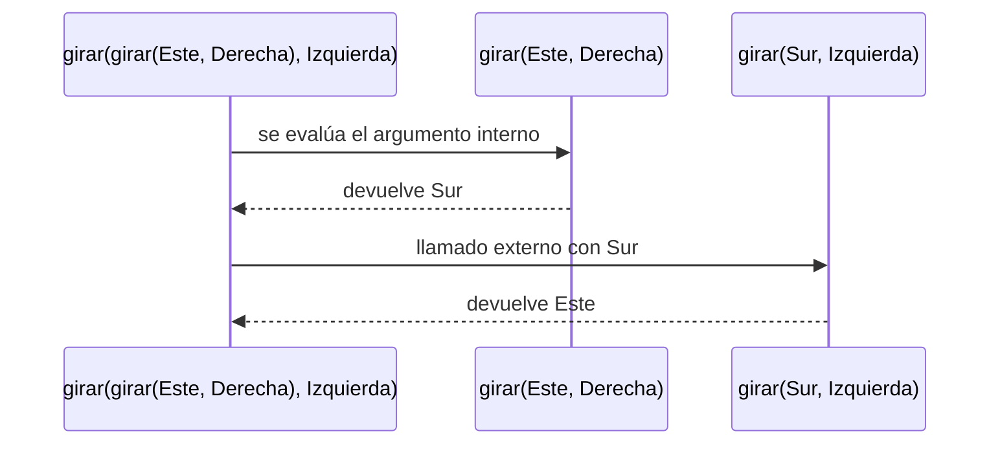

---

## Ejemplo 4: cuatro giros a la derecha

```scala
List(Derecha, Derecha, Derecha, Derecha)
  .foldLeft(Norte: Direccion)((d, s) => girar(d, s))
```

`foldLeft` arranca con `Norte` y le aplica `girar` con cada elemento de la
lista, usando el resultado anterior como nueva dirección.

| Paso | Llamado | Resultado |
|---|---|---|
| 1 | `girar(Norte, Derecha)` | `Este` |
| 2 | `girar(Este, Derecha)`  | `Sur` |
| 3 | `girar(Sur, Derecha)`   | `Oeste` |
| 4 | `girar(Oeste, Derecha)` | `Norte` |

Después de cuatro giros el robot vuelve a mirar al norte.

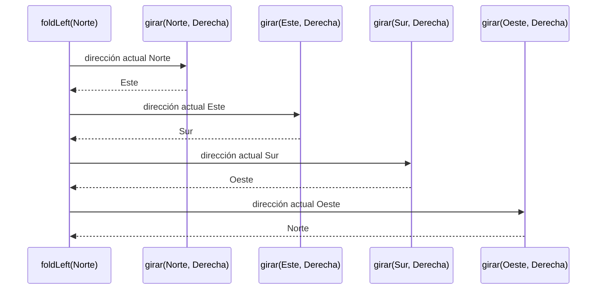

Cada llamado a `girar` termina antes de que empiece el siguiente, así que la
pila nunca tiene más de un llamado de `girar` a la vez.

---

# Informe de proceso — Punto 2: `ejecutar`

## Definición de la función

```scala
def ejecutar(e: Estado, o: Orden): Estado = (e, o) match {
  case (Estado(x, y, mira), Girar(sentido)) => Estado(x, y, girar(mira, sentido))
  case (Estado(x, y, Norte), Avanzar(n))    => Estado(x, y + n, Norte)
  case (Estado(x, y, Sur), Avanzar(n))      => Estado(x, y - n, Sur)
  case (Estado(x, y, Oeste), Avanzar(n))    => Estado(x - n, y, Oeste)
  case (Estado(x, y, Este), Avanzar(n))     => Estado(x + n, y, Este)

  case (x, Repetir(veces, orden)) => veces match {
    case n if n <= 0 => e
    case repetir     => ejecutar(ejecutar(e, orden), Repetir(veces - 1, orden))
  }

  case (x, Secuencia(ordenes)) => ordenes match {
    case Nil             => e
    case primera :: resto => ejecutar(ejecutar(e, primera), Secuencia(resto))
  }
}
```

* La función recibe el estado del robot (`e`) y una orden (`o`), y devuelve el
  estado en que queda el robot después de cumplirla.
* Hace `match` sobre la pareja `(e, o)`, con un caso por cada alternativa de
  `Orden`.
* **Casos básicos** (`Girar`, `Avanzar`): construyen el estado nuevo
  directamente y **no** llaman a `ejecutar`.
  * `Girar` deja `x` y `y` iguales y cambia la dirección usando `girar` del
    punto 1.
  * `Avanzar` deja la dirección igual y suma o resta `n` a `x` o a `y` según
    hacia dónde mira el robot.
* **Casos compuestos** (`Repetir`, `Secuencia`): llaman a `ejecutar` **dos
  veces**, una dentro de la otra:

```scala
ejecutar( ejecutar(e, LO_QUE_SE_HACE_UNA_VEZ), LO_QUE_FALTA )
```

| Caso | Lo que se hace una vez | Lo que falta | Cuándo para |
|---|---|---|---|
| `Repetir(veces, orden)` | `orden` | `Repetir(veces - 1, orden)` | `veces <= 0` |
| `Secuencia(primera :: resto)` | `primera` | `Secuencia(resto)` | la lista es `Nil` |

Scala evalúa primero los argumentos, así que el llamado de adentro termina y
su resultado (un estado nuevo) es el punto de partida del llamado de afuera.
En cada llamado de afuera la orden que queda es más pequeña (una vez menos, o
una orden menos en la lista), así que siempre se llega al caso que para.

---

## Ejemplo 1: una secuencia corta

```scala
ejecutar(Estado(0, 0, Norte), Secuencia(List(Avanzar(2), Girar(Derecha), Avanzar(4))))
```

Para abreviar, un estado se escribe `(x, y, dirección)` y `Secuencia(List(...))`
se escribe `Sec[...]`.

| Paso | Llamado | Caso que aplica | Resultado |
|---|---|---|---|
| 1 | `ejecutar((0,0,N), Sec[Avanzar(2), Girar(D), Avanzar(4)])` | `primera :: resto` | `ejecutar(ejecutar((0,0,N), Avanzar(2)), Sec[Girar(D), Avanzar(4)])` |
| 2 | `ejecutar((0,0,N), Avanzar(2))` | `Avanzar` al norte | `(0,2,N)` |
| 3 | `ejecutar((0,2,N), Sec[Girar(D), Avanzar(4)])` | `primera :: resto` | `ejecutar(ejecutar((0,2,N), Girar(D)), Sec[Avanzar(4)])` |
| 4 | `ejecutar((0,2,N), Girar(D))` | `Girar` | `(0,2,E)` |
| 5 | `ejecutar((0,2,E), Sec[Avanzar(4)])` | `primera :: resto` | `ejecutar(ejecutar((0,2,E), Avanzar(4)), Sec[])` |
| 6 | `ejecutar((0,2,E), Avanzar(4))` | `Avanzar` al este | `(4,2,E)` |
| 7 | `ejecutar((4,2,E), Sec[])` | `Nil` | **`(4,2,E)`** |

En cada paso la lista pierde su primera orden, y el estado que deja esa orden
es el que recibe el resto de la lista.

---

## Ejemplo 2: el cuadrado

```scala
ejecutar(Estado(0, 0, Norte), Repetir(4, Secuencia(List(Avanzar(1), Girar(Derecha)))))
```

Llamamos `C` al cuerpo que se repite:

```scala
C = Secuencia(List(Avanzar(1), Girar(Derecha)))
```

### Primera vuelta, paso a paso

| Paso | Estado | Orden que queda por ejecutar | Caso que aplica | Qué produce |
|---|---|---|---|---|
| 1 | `(0,0,N)` | `Repetir(4, C)` | `Repetir`, 4 > 0 | `ejecutar(ejecutar((0,0,N), C), Repetir(3, C))` |
| 2 | `(0,0,N)` | `C = Sec[Avanzar(1), Girar(D)]` | `primera :: resto` | `ejecutar(ejecutar((0,0,N), Avanzar(1)), Sec[Girar(D)])` |
| 3 | `(0,0,N)` | `Avanzar(1)` | `Avanzar` al norte | `(0,1,N)` |
| 4 | `(0,1,N)` | `Sec[Girar(D)]` | `primera :: resto` | `ejecutar(ejecutar((0,1,N), Girar(D)), Sec[])` |
| 5 | `(0,1,N)` | `Girar(D)` | `Girar` | `(0,1,E)` |
| 6 | `(0,1,E)` | `Sec[]` | `Nil` | `(0,1,E)` |
| 7 | `(0,1,E)` | `Repetir(3, C)` | `Repetir`, 3 > 0 | comienza la segunda vuelta |

Los pasos 2 a 6 son el llamado de adentro del paso 1: ejecutar `C` una vez.
Cuando termina, su resultado `(0,1,E)` pasa a ser el estado del llamado de
afuera, `Repetir(3, C)`.

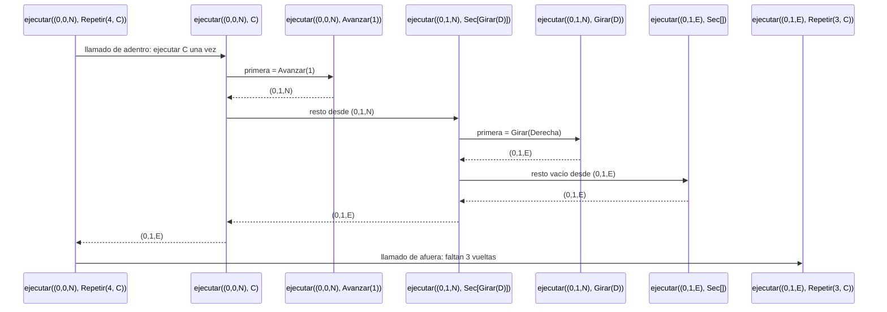

### Las cuatro vueltas

Cada vuelta repite los pasos 2 a 6 desde el estado que dejó la anterior:

| Vuelta | Estado al empezar | Tras `Avanzar(1)` | Tras `Girar(Derecha)` | Orden que queda |
|---|---|---|---|---|
| 1 | `(0,0,N)` | `(0,1,N)` | `(0,1,E)` | `Repetir(3, C)` |
| 2 | `(0,1,E)` | `(1,1,E)` | `(1,1,S)` | `Repetir(2, C)` |
| 3 | `(1,1,S)` | `(1,0,S)` | `(1,0,O)` | `Repetir(1, C)` |
| 4 | `(1,0,O)` | `(0,0,O)` | `(0,0,N)` | `Repetir(0, C)` |

### Final

```scala
ejecutar((0,0,N), Repetir(0, C))   // veces <= 0 → devuelve el estado tal cual
```

El resultado es **`Estado(0, 0, Norte)`**: el robot recorre un cuadrado de lado
1 y vuelve al origen mirando al norte.

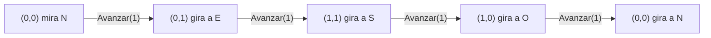

### Cuántos llamados se hacen

Cada vuelta hace 6 llamados a `ejecutar`: uno para `Repetir`, tres para la
secuencia (con 2 órdenes, con 1 y vacía), uno para `Avanzar` y uno para
`Girar`. Con 4 vueltas son $4 \times 6 = 24$ llamados, más el último con
`Repetir(0, C)`:

```math
4 \times 6 + 1 = 25 \text{ llamados a } \texttt{ejecutar}
```

De esos, solo 8 son órdenes básicas (4 `Avanzar` y 4 `Girar`), que son las que
de verdad mueven o giran al robot. Los demás solo reparten el trabajo entre el
llamado de adentro y el de afuera.

---

# Informe de proceso — Punto 3: `cuantasBasicas` y `profundidad`

## Definición de las funciones

```scala
def cuantasBasicas(o: Orden): Int = o match {
  case Avanzar(_)            => 1
  case Girar(_)              => 1
  case Repetir(veces, orden) => math.max(veces, 0) * cuantasBasicas(orden)
  case Secuencia(ordenes)    => ordenes.map(cuantasBasicas).sum
}

def profundidad(o: Orden): Int = o match {
  case Avanzar(_)         => 1
  case Girar(_)           => 1
  case Repetir(_, orden)  => 1 + profundidad(orden)
  case Secuencia(ordenes) => 1 + ordenes.map(profundidad).maxOption.getOrElse(0)
}
```

* Las dos funciones reciben una orden y devuelven un número **sin
  ejecutarla**: no reciben un estado, solo miran cómo está armada la orden.
* Hacen `match` sobre la orden, con un caso por cada alternativa de `Orden`.
* **Casos básicos** (`Avanzar`, `Girar`): devuelven `1` directamente y no se
  llaman a sí mismas. Los pasos y el sentido no importan, por eso se escribe
  `_`.
* **Casos compuestos** (`Repetir`, `Secuencia`): se llaman a sí mismas sobre
  las órdenes que contienen y combinan los resultados:

| Caso | `cuantasBasicas` | `profundidad` |
|---|---|---|
| `Repetir(veces, orden)` | lo de `orden` multiplicado por `max(veces, 0)` | `1` más lo de `orden` |
| `Secuencia(ordenes)` | la suma de lo de cada orden de la lista | `1` más el mayor de la lista |

* `math.max(veces, 0)` hace que repetir cero o menos veces cuente `0`, igual
  que en `ejecutar`, donde `Repetir` con `veces <= 0` no hace nada.
* `ordenes.map(cuantasBasicas)` le pasa la misma función a `map` como
  argumento: `map` la aplica a cada orden de la lista y devuelve la lista de
  resultados. `sum` los suma, y la suma de la lista vacía es `0`.
* `maxOption` devuelve `Some(mayor)` si la lista tiene elementos y `None` si
  está vacía, y `getOrElse(0)` cambia `None` por `0`. Se usa en lugar de
  `max` porque `max` sobre una lista vacía lanza una excepción. Así
  `Secuencia(Nil)` tiene profundidad $1 + 0 = 1$, como pide el enunciado.

---

## Ejemplo 1: `cuantasBasicas(cuadrado)`

```scala
val cuadrado = Repetir(4, Secuencia(List(Avanzar(1), Girar(Derecha))))
cuantasBasicas(cuadrado)
```

Como en el punto 2, llamamos `C` al cuerpo que se repite:

```scala
C = Secuencia(List(Avanzar(1), Girar(Derecha)))
```

| Paso | Llamado | Caso que aplica | Resultado |
|---|---|---|---|
| 1 | `cuantasBasicas(Repetir(4, C))` | `Repetir` | `math.max(4, 0) * cuantasBasicas(C)` = `4 * cuantasBasicas(C)` |
| 2 | `cuantasBasicas(C)` | `Secuencia` | `List(cuantasBasicas(Avanzar(1)), cuantasBasicas(Girar(D))).sum` |
| 3 | `cuantasBasicas(Avanzar(1))` | `Avanzar` | `1` |
| 4 | `cuantasBasicas(Girar(D))` | `Girar` | `1` |
| 5 | vuelve al paso 2 | — | `List(1, 1).sum` = `2` |
| 6 | vuelve al paso 1 | — | `4 * 2` = **`8`** |

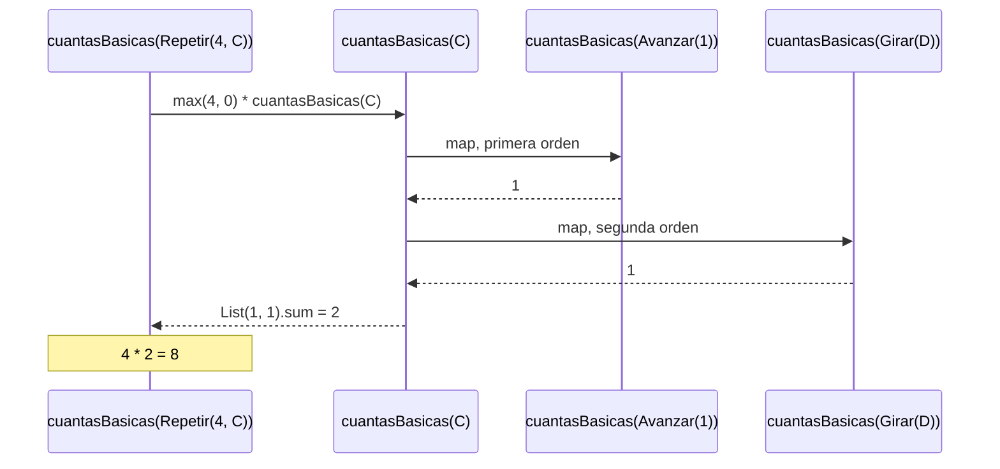

### Las 8 básicas en la traza del robot

Ese `8` son las órdenes básicas que `ejecutar` aplica cuando recorre el
cuadrado (punto 2). Si se anota el estado después de cada una:

| Básica | Orden | Estado después |
|---|---|---|
| 1 | `Avanzar(1)` | `(0,1,N)` |
| 2 | `Girar(D)`   | `(0,1,E)` |
| 3 | `Avanzar(1)` | `(1,1,E)` |
| 4 | `Girar(D)`   | `(1,1,S)` |
| 5 | `Avanzar(1)` | `(1,0,S)` |
| 6 | `Girar(D)`   | `(1,0,O)` |
| 7 | `Avanzar(1)` | `(0,0,O)` |
| 8 | `Girar(D)`   | `(0,0,N)` |

La diferencia está en el trabajo. `ejecutar` necesita 25 llamados para
recorrer el cuadrado, mientras que `cuantasBasicas` hace solo 4, uno por cada
orden que aparece escrita (`Repetir`, `C`, `Avanzar(1)` y `Girar(D)`), porque
multiplica por 4 en lugar de repetir. Con `Repetir(1000, C)` seguirían
siendo 4 llamados y el resultado sería `2000`.

---

## Ejemplo 2: repeticiones anidadas

```scala
cuantasBasicas(Repetir(2, Repetir(3, Girar(Derecha))))
```

| Paso | Llamado | Caso que aplica | Resultado |
|---|---|---|---|
| 1 | `cuantasBasicas(Repetir(2, Repetir(3, Girar(D))))` | `Repetir` | `2 * cuantasBasicas(Repetir(3, Girar(D)))` |
| 2 | `cuantasBasicas(Repetir(3, Girar(D)))` | `Repetir` | `3 * cuantasBasicas(Girar(D))` |
| 3 | `cuantasBasicas(Girar(D))` | `Girar` | `1` |
| 4 | vuelve al paso 2 | — | `3 * 1` = `3` |
| 5 | vuelve al paso 1 | — | `2 * 3` = **`6`** |

Las veces de los dos `Repetir` se multiplican. Al ejecutar esa orden desde
el origen, el robot no se mueve de casilla, solo gira seis veces a la
derecha:

| Giro | 1 | 2 | 3 | 4 | 5 | 6 |
|---|---|---|---|---|---|---|
| Estado | `(0,0,E)` | `(0,0,S)` | `(0,0,O)` | `(0,0,N)` | `(0,0,E)` | `(0,0,S)` |

Los seis giros cuentan como seis básicas aunque el robot no cambie de
casilla.

Con veces negativas el resultado es `0`:

```scala
cuantasBasicas(Repetir(-2, Avanzar(1)))   // math.max(-2, 0) * 1 = 0 * 1 = 0
```

y efectivamente `ejecutar(inicial, Repetir(-2, Avanzar(1)))` deja al robot en
`(0,0,N)`, sin hacer nada.

---

## Ejemplo 3: `profundidad(cuadrado)`

| Paso | Llamado | Caso que aplica | Resultado |
|---|---|---|---|
| 1 | `profundidad(Repetir(4, C))` | `Repetir` | `1 + profundidad(C)` |
| 2 | `profundidad(C)` | `Secuencia` | `1 + List(profundidad(Avanzar(1)), profundidad(Girar(D))).maxOption.getOrElse(0)` |
| 3 | `profundidad(Avanzar(1))` | `Avanzar` | `1` |
| 4 | `profundidad(Girar(D))` | `Girar` | `1` |
| 5 | vuelve al paso 2 | — | `List(1, 1).maxOption` = `Some(1)`, `getOrElse(0)` = `1`, `1 + 1` = `2` |
| 6 | vuelve al paso 1 | — | `1 + 2` = **`3`** |

La profundidad es la cantidad de niveles del árbol de la orden:

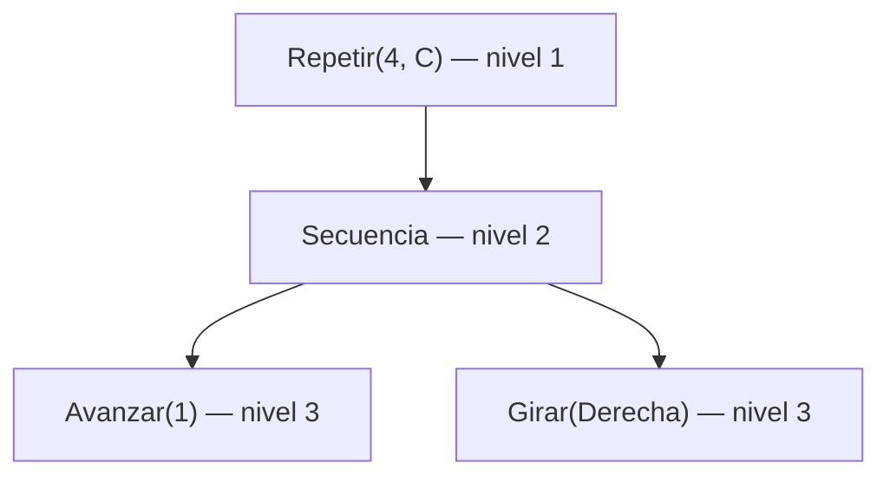

El `4` de `Repetir` no entra en la cuenta: `profundidad(Repetir(n, C))` da
`3` para cualquier `n`, porque `Repetir(_, orden)` ignora las veces.

---

## Ejemplo 4: manda la rama más honda

```scala
profundidad(Secuencia(List(Avanzar(1), cuadrado)))
```

| Paso | Llamado | Resultado |
|---|---|---|
| 1 | `profundidad(Secuencia(List(Avanzar(1), cuadrado)))` | `1 + List(profundidad(Avanzar(1)), profundidad(cuadrado)).maxOption.getOrElse(0)` |
| 2 | `profundidad(Avanzar(1))` | `1` |
| 3 | `profundidad(cuadrado)` | `3` (los pasos del ejemplo 3) |
| 4 | vuelve al paso 1 | `List(1, 3).maxOption` = `Some(3)`, `1 + 3` = **`4`** |

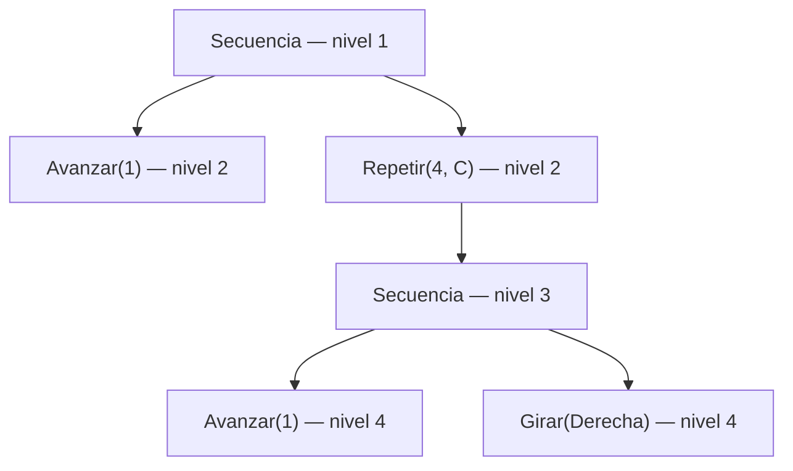

La rama de `Avanzar(1)` termina en el nivel 2 y la del cuadrado en el 4;
`maxOption` se queda con la mayor.

Esta orden tiene `cuantasBasicas` = $1 + 8 = 9$, y al ejecutarla desde el
origen el robot pasa por 9 estados, uno por cada básica: primero avanza y
después recorre el cuadrado desde `(0,1)`.

| Básica | 1 | 2 | 3 | 4 | 5 | 6 | 7 | 8 | 9 |
|---|---|---|---|---|---|---|---|---|---|
| Estado | `(0,1,N)` | `(0,2,N)` | `(0,2,E)` | `(1,2,E)` | `(1,2,S)` | `(1,1,S)` | `(1,1,O)` | `(0,1,O)` | `(0,1,N)` |

---

## Ejemplo 5: la secuencia vacía

```scala
profundidad(Secuencia(Nil))
```

### Paso 1: Caso `Secuencia`

```scala
1 + Nil.map(profundidad).maxOption.getOrElse(0)
```

### Paso 2: `map` sobre la lista vacía

```scala
Nil.map(profundidad)   // Nil
```

### Paso 3: `maxOption` y `getOrElse`

```scala
Nil.maxOption          // None
None.getOrElse(0)      // 0
```

### Paso 4: Resultado

```scala
1 + 0                  // 1
```

De la misma forma, `cuantasBasicas(Secuencia(Nil))` es `Nil.sum` = `0`: la
secuencia vacía es un nivel del árbol, pero no ejecuta ninguna básica y el
robot se queda en `(0,0,N)`.

---

# Informe de proceso — Punto 4: `componer`, `rutina`, `aplicarA` y `transformar`

## Definición de las funciones

```scala
def componer(o1: Orden, o2: Orden): Orden = Secuencia(List(o1, o2))

def rutina(pasos: Int)(giro: Sentido)(veces: Int): Orden =
  Repetir(veces, Secuencia(List(Avanzar(pasos), Girar(giro))))

def aplicarA(estados: List[Estado], o: Orden): List[Estado] =
  estados.map(e => ejecutar(e, o))

def transformar(o: Orden, f: Orden => Orden): Orden = o match {
  case Avanzar(_)            => f(o)
  case Girar(_)              => f(o)
  case Repetir(veces, orden) => Repetir(veces, transformar(orden, f))
  case Secuencia(ordenes)    => Secuencia(ordenes.map(x => transformar(x, f)))
}
```

* Ninguna de las cuatro mueve al robot por su cuenta: `componer`, `rutina` y
  `transformar` **construyen órdenes nuevas**, y `aplicarA` usa `ejecutar`
  del punto 2.
* `componer` arma una `Secuencia` con las dos órdenes, sin mirarlas por
  dentro.
* `rutina` está **currificada**: tiene tres listas de parámetros. Si se le
  dan solo las dos primeras, `rutina(pasos)(giro) _` es una función
  `Int => Orden` que todavía espera las veces. (En Scala 2.13 el `_` le dice
  al compilador que queremos esa función y no el resultado).
* `aplicarA` le pasa a `map` la función `e => ejecutar(e, o)`: la misma orden
  `o` se ejecuta sobre cada estado de la lista.
* `transformar` recibe una función `f: Orden => Orden` y recorre la orden con
  `match`, como las del punto 3. En las básicas aplica `f`; en las compuestas
  arma la misma compuesta con las órdenes de adentro ya transformadas.

| Función | Recibe una función | Devuelve una función | Es recursiva |
|---|---|---|---|
| `componer` | no | no | no |
| `rutina` | no | sí, si se le dan solo `pasos` y `giro` | no |
| `aplicarA` | no (ella le pasa una a `map`) | no | no |
| `transformar` | sí, `f: Orden => Orden` | no | sí |

---

## Ejemplo 1: `componer` y lo que hace el robot

### Paso 1: Llamada inicial

```scala
componer(Avanzar(2), Girar(Derecha))
```

### Paso 2: Se sustituye el cuerpo

```scala
Secuencia(List(Avanzar(2), Girar(Derecha)))
```

### Paso 3: Se ejecuta la compuesta

| Paso | Llamado | Caso que aplica | Resultado |
|---|---|---|---|
| 1 | `ejecutar((0,0,N), Sec[Avanzar(2), Girar(D)])` | `primera :: resto` | `ejecutar(ejecutar((0,0,N), Avanzar(2)), Sec[Girar(D)])` |
| 2 | `ejecutar((0,0,N), Avanzar(2))` | `Avanzar` al norte | `(0,2,N)` |
| 3 | `ejecutar((0,2,N), Sec[Girar(D)])` | `primera :: resto` | `ejecutar(ejecutar((0,2,N), Girar(D)), Sec[])` |
| 4 | `ejecutar((0,2,N), Girar(D))` | `Girar` | `(0,2,E)` |
| 5 | `ejecutar((0,2,E), Sec[])` | `Nil` | **`(0,2,E)`** |

### Paso 4: Se ejecutan las partes por separado

```scala
ejecutar(ejecutar(inicial, Avanzar(2)), Girar(Derecha))
ejecutar((0,2,N), Girar(Derecha))     // el de adentro dio (0,2,N)
(0,2,E)
```

Las dos formas dejan al robot en `(0,2,E)`. Los pasos 2 y 4 de la tabla son
justo los dos llamados de las partes; los pasos 1, 3 y 5 solo reparten el
trabajo de la secuencia.

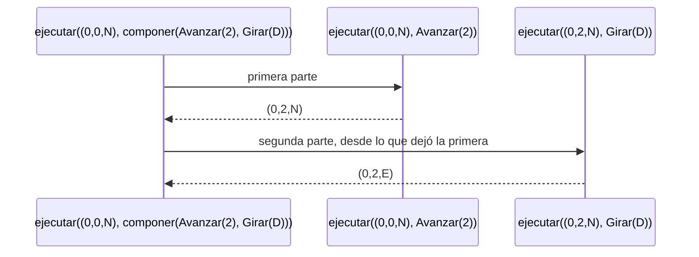

### Componer tres órdenes

Con `a = Avanzar(1)`, `b = Girar(Izquierda)` y `c = Avanzar(2)`:

```scala
componer(componer(a, b), c)   // Sec[Sec[a, b], c]
componer(a, componer(b, c))   // Sec[a, Sec[b, c]]
```

Son órdenes distintas, porque `componer` no aplana las secuencias, pero el
robot pasa por los mismos estados en las dos:

| Orden que se ejecuta | Estado después |
|---|---|
| — | `(0,0,N)` |
| `Avanzar(1)` | `(0,1,N)` |
| `Girar(I)` | `(0,1,O)` |
| `Avanzar(2)` | `(-2,1,O)` |

El orden de las partes sí importa: `componer(Girar(Derecha), Avanzar(3))`
deja al robot en `(3,0,E)`, y `componer(Avanzar(3), Girar(Derecha))` en
`(0,3,E)`.

---

## Ejemplo 2: `rutina` paso a paso (currificación)

```scala
val cuadradoDe = rutina(1)(Derecha) _
ejecutar(inicial, cuadradoDe(4))
```

| Expresión | Qué es | Tipo |
|---|---|---|
| `rutina` | el método con sus tres listas de parámetros | `(pasos: Int)(giro: Sentido)(veces: Int): Orden` |
| `rutina(1)(Derecha) _` | una función con `pasos = 1` y `giro = Derecha` ya fijados | `Int => Orden` |
| `cuadradoDe(4)` | la orden, cuando por fin llegan las veces | `Orden` |

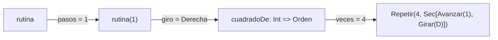

### Paso 1: Se aplica la función a las veces

```scala
cuadradoDe(4)
```

### Paso 2: Se sustituye el cuerpo de `rutina` con `pasos = 1`, `giro = Derecha`, `veces = 4`

```scala
Repetir(4, Secuencia(List(Avanzar(1), Girar(Derecha))))
```

### Paso 3: Resultado

Es el mismo `cuadrado` del enunciado, así que `ejecutar` sigue la traza del
punto 2 (las cuatro vueltas) y termina en **`(0,0,N)`**.

La misma función sirve para cualquier cantidad de vueltas, sin volver a dar
los pasos ni el giro:

| `veces` | Orden | Estado final desde `(0,0,N)` |
|---|---|---|
| 0 | `Repetir(0, C)` | `(0,0,N)` |
| 1 | `Repetir(1, C)` | `(0,1,E)` |
| 2 | `Repetir(2, C)` | `(1,1,S)` |
| 4 | `Repetir(4, C)` | `(0,0,N)` |

### Cuadrado de lado 2

```scala
ejecutar(inicial, rutina(2)(Derecha)(4))
```

| Vuelta | Estado al empezar | Tras `Avanzar(2)` | Tras `Girar(Derecha)` |
|---|---|---|---|
| 1 | `(0,0,N)` | `(0,2,N)` | `(0,2,E)` |
| 2 | `(0,2,E)` | `(2,2,E)` | `(2,2,S)` |
| 3 | `(2,2,S)` | `(2,0,S)` | `(2,0,O)` |
| 4 | `(2,0,O)` | `(0,0,O)` | `(0,0,N)` |

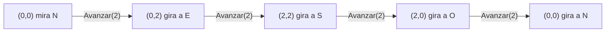

Con lado 2 el robot también vuelve al origen mirando al norte.

---

## Ejemplo 3: `aplicarA`

```scala
aplicarA(List(inicial, Estado(5, 5, Sur)), Avanzar(2))
```

### Paso 1: Se sustituye el cuerpo

```scala
List((0,0,N), (5,5,S)).map(e => ejecutar(e, Avanzar(2)))
```

### Paso 2: `map` aplica la función a cada estado, en orden

| Posición | Estado | Llamado | Resultado |
|---|---|---|---|
| 1 | `(0,0,N)` | `ejecutar((0,0,N), Avanzar(2))` | `(0,2,N)` |
| 2 | `(5,5,S)` | `ejecutar((5,5,S), Avanzar(2))` | `(5,3,S)` |

### Paso 3: Resultado

```scala
List((0,2,N), (5,3,S))
```

Cada estado se ejecuta por separado: el resultado del primero no influye en
el segundo, y la lista sale del mismo tamaño y en el mismo orden.

### El cuadrado sobre varios estados

```scala
aplicarA(List(inicial, Estado(4, -2, Oeste), Estado(-3, 7, Sur)), cuadrado)
```

Cada robot recorre su propio cuadrado y vuelve a donde empezó, así que la
lista que sale es la misma que entra. La traza del segundo estado, que
empieza mirando al oeste:

| Básica | Orden | Estado después |
|---|---|---|
| — | — | `(4,-2,O)` |
| 1 | `Avanzar(1)` | `(3,-2,O)` |
| 2 | `Girar(D)`   | `(3,-2,N)` |
| 3 | `Avanzar(1)` | `(3,-1,N)` |
| 4 | `Girar(D)`   | `(3,-1,E)` |
| 5 | `Avanzar(1)` | `(4,-1,E)` |
| 6 | `Girar(D)`   | `(4,-1,S)` |
| 7 | `Avanzar(1)` | `(4,-2,S)` |
| 8 | `Girar(D)`   | `(4,-2,O)` |

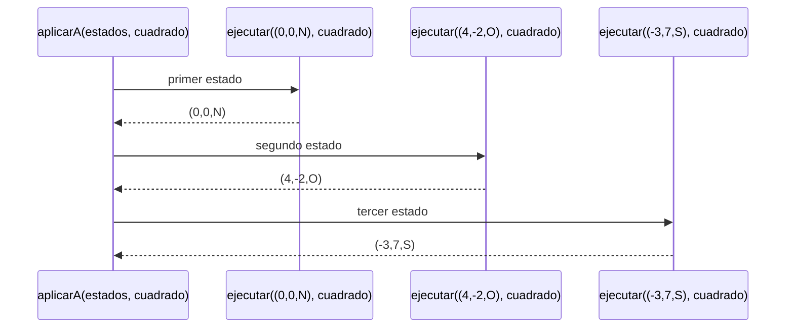

---

## Ejemplo 4: `transformar` duplicando los avances

```scala
transformar(cuadrado, {
  case Avanzar(n) => Avanzar(2 * n)
  case otra => otra
})
```

Llamamos `doblar` a la función que se pasa como `f`.

| Paso | Llamado | Caso que aplica | Resultado |
|---|---|---|---|
| 1 | `transformar(Repetir(4, C), doblar)` | `Repetir` | `Repetir(4, transformar(C, doblar))` |
| 2 | `transformar(C, doblar)` | `Secuencia` | `Secuencia(List(transformar(Avanzar(1), doblar), transformar(Girar(D), doblar)))` |
| 3 | `transformar(Avanzar(1), doblar)` | `Avanzar` | `doblar(Avanzar(1))` = `Avanzar(2)` |
| 4 | `transformar(Girar(D), doblar)` | `Girar` | `doblar(Girar(D))` = `Girar(D)` (cae en `case otra`) |
| 5 | vuelve al paso 2 | — | `Secuencia(List(Avanzar(2), Girar(D)))` |
| 6 | vuelve al paso 1 | — | **`Repetir(4, Secuencia(List(Avanzar(2), Girar(D))))`** |

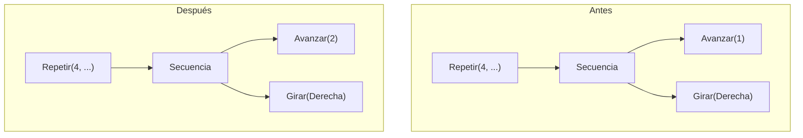

El árbol tiene la misma forma; solo cambiaron las hojas donde `f` hizo algo.
El `4` de `Repetir` no se toca, porque `transformar` copia las veces tal
cual.

El resultado es igual a `rutina(2)(Derecha)(4)`, así que el robot recorre el
cuadrado de lado 2 del ejemplo 2: `(0,2,E)`, `(2,2,S)`, `(2,0,O)` y vuelve a
`(0,0,N)`.

---

## Ejemplo 5: `transformar` cambiando el sentido de los giros

```scala
val alReves: Orden => Orden = {
  case Girar(Derecha)   => Girar(Izquierda)
  case Girar(Izquierda) => Girar(Derecha)
  case otra             => otra
}
transformar(cuadrado, alReves)
```

Siguiendo los mismos pasos del ejemplo 4, `alReves(Avanzar(1))` deja el
avance igual y `alReves(Girar(Derecha))` da `Girar(Izquierda)`:

```scala
Repetir(4, Secuencia(List(Avanzar(1), Girar(Izquierda))))   // = rutina(1)(Izquierda)(4)
```

Ahora el robot dibuja el cuadrado hacia el otro lado:

| Vuelta | Estado al empezar | Tras `Avanzar(1)` | Tras `Girar(Izquierda)` |
|---|---|---|---|
| 1 | `(0,0,N)` | `(0,1,N)` | `(0,1,O)` |
| 2 | `(0,1,O)` | `(-1,1,O)` | `(-1,1,S)` |
| 3 | `(-1,1,S)` | `(-1,0,S)` | `(-1,0,E)` |
| 4 | `(-1,0,E)` | `(0,0,E)` | `(0,0,N)` |

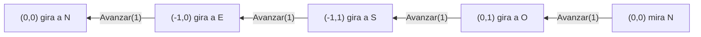

Con la derecha el cuadrado queda en las casillas con $x \ge 0$; con la
izquierda, en las de $x \le 0$. En los dos casos el robot termina en
`(0,0,N)`.

---

# Informe de proceso — Punto 5: `simplificar`

## Definición de la función

```scala
def simplificar(o: Orden): Orden = {

  def reducir(ordenes: List[Orden]): List[Orden] = ordenes match {
    case Nil                               => Nil
    case Avanzar(0) :: resto               => reducir(resto)
    case Secuencia(internas) :: resto      => internas ++ reducir(resto)
    case Avanzar(a) :: Avanzar(b) :: resto => reducir(Avanzar(a + b) :: resto)
    case primera :: resto                  => primera :: reducir(resto)
  }

  def pasada(o: Orden): Orden = o match {
    case Avanzar(_)                      => o
    case Girar(_)                        => o
    case Repetir(veces, _) if veces <= 0 => Secuencia(Nil)
    case Repetir(1, orden)               => orden
    case Repetir(_, Secuencia(Nil))      => Secuencia(Nil)
    case Repetir(veces, orden)           => Repetir(veces, pasada(orden))
    case Secuencia(List(unica))          => unica
    case Secuencia(ordenes)              => Secuencia(reducir(ordenes).map(pasada))
  }

  def hastaQueNoCambie(actual: Orden): Orden = {
    val siguiente = pasada(actual)
    if (siguiente == actual) actual else hastaQueNoCambie(siguiente)
  }

  hastaQueNoCambie(o)
}
```

La función tiene tres partes:

- `reducir` trabaja sobre la lista de una secuencia. Quita los `Avanzar(0)`,
  mete en la lista los elementos de las secuencias que vienen adentro y junta
  dos avances seguidos en uno solo.
- `pasada` aplica las reglas **en el nodo** que recibe y después baja a lo
  que ese nodo contiene. Lo que aparece nuevo después de aplicar una regla
  (por ejemplo, la orden que estaba dentro de un `Repetir(1, ...)`) no se
  vuelve a revisar en la misma pasada.
- `hastaQueNoCambie` repite pasadas hasta que una deja la orden igual. Ese es
  el punto fijo, y es lo que devuelve `simplificar`.

Las reglas, en resumen:

| Regla | Antes | Después |
|---|---|---|
| R1 | `Repetir(n, o)` con $n \le 0$ | `Secuencia(Nil)` |
| R2 | `Repetir(1, o)` | `o` |
| R3 | `Repetir(n, Secuencia(Nil))` | `Secuencia(Nil)` |
| R4 | `Secuencia(List(u))` | `u` |
| R5 | `Avanzar(0)` dentro de una secuencia | se quita |
| R6 | `Secuencia(internas)` dentro de una secuencia | sus elementos quedan en la lista de afuera |
| R7 | `Avanzar(a)`, `Avanzar(b)` seguidos en una secuencia | `Avanzar(a + b)` |

---

## Ejemplo: una orden que necesita varias pasadas

```scala
simplificar(Secuencia(List(Avanzar(1), Repetir(1, Secuencia(List(Avanzar(0), Avanzar(5)))))))
```

Para abreviar escribimos `A(n)` por `Avanzar(n)`, `Sec[...]` por
`Secuencia(List(...))` y `Rep(n, o)` por `Repetir(n, o)`. La orden de
entrada es:

```
Sec[A(1), Rep(1, Sec[A(0), A(5)])]
```

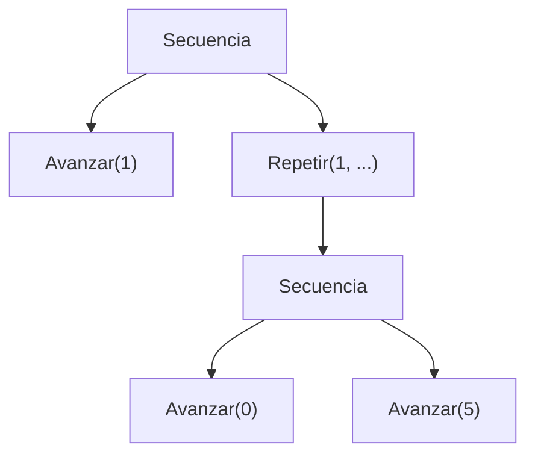

### Pasada 1

`pasada` recibe una secuencia de dos elementos, así que no aplica R4 y entra
al último caso.

| Paso | Llamado | Caso que aplica | Resultado |
|---|---|---|---|
| 1 | `reducir([A(1), Rep(1, ...)])` | `primera :: resto` | `A(1) :: reducir([Rep(1, ...)])` |
| 2 | `reducir([Rep(1, ...)])` | `primera :: resto` | `Rep(1, ...) :: reducir(Nil)` |
| 3 | `reducir(Nil)` | `Nil` | `Nil` |
| 4 | `map(pasada)` sobre `[A(1), Rep(1, Sec[A(0), A(5)])]` | `Avanzar` y R2 | `[A(1), Sec[A(0), A(5)]]` |

Resultado de la pasada 1:

```
Sec[A(1), Sec[A(0), A(5)]]
```

R2 quitó el `Repetir`, pero la secuencia que quedó adentro no se revisa en
esta pasada: `pasada` ya bajó por ese nodo.

### Pasada 2

| Paso | Llamado | Caso que aplica | Resultado |
|---|---|---|---|
| 1 | `reducir([A(1), Sec[A(0), A(5)]])` | `primera :: resto` (el segundo no es un avance) | `A(1) :: reducir([Sec[A(0), A(5)]])` |
| 2 | `reducir([Sec[A(0), A(5)]])` | R6 | `[A(0), A(5)] ++ reducir(Nil)` = `[A(0), A(5)]` |
| 3 | `map(pasada)` sobre `[A(1), A(0), A(5)]` | `Avanzar` | `[A(1), A(0), A(5)]` |

Resultado de la pasada 2:

```
Sec[A(1), A(0), A(5)]
```

### Pasada 3

| Paso | Llamado | Caso que aplica | Resultado |
|---|---|---|---|
| 1 | `reducir([A(1), A(0), A(5)])` | R7 con $a = 1, b = 0$ | `reducir([A(1), A(5)])` |
| 2 | `reducir([A(1), A(5)])` | R7 con $a = 1, b = 5$ | `reducir([A(6)])` |
| 3 | `reducir([A(6)])` | `primera :: resto` | `[A(6)]` |
| 4 | `map(pasada)` sobre `[A(6)]` | `Avanzar` | `[A(6)]` |

Resultado de la pasada 3:

```
Sec[A(6)]
```

En el paso 1 el `A(0)` se juntó con el `A(1)` antes de que R5 lo quitara;
da lo mismo, porque sumar cero no cambia el avance.

### Pasada 4

`pasada(Sec[A(6)])` entra por R4 y devuelve `A(6)`.

### Pasada 5

`pasada(A(6))` devuelve `A(6)`. Como es igual a la orden que entró,
`hastaQueNoCambie` se detiene.

### Resumen

| Pasada | Orden que sale | Regla que actuó | Nodos del árbol |
|---|---|---|---|
| entrada | `Sec[A(1), Rep(1, Sec[A(0), A(5)])]` | — | 6 |
| 1 | `Sec[A(1), Sec[A(0), A(5)]]` | R2 | 5 |
| 2 | `Sec[A(1), A(0), A(5)]` | R6 | 4 |
| 3 | `Sec[A(6)]` | R7 dos veces | 2 |
| 4 | `A(6)` | R4 | 1 |
| 5 | `A(6)` | ninguna: punto fijo | 1 |

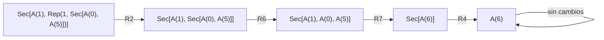

Cada pasada que cambia algo deja el árbol con menos nodos, y por eso las
pasadas no pueden seguir para siempre (ver el informe de corrección).

### Lo que hace el robot

Desde el estado inicial, la orden original y la simplificada llevan al mismo
lugar:

| Orden | Estados por los que pasa | Final |
|---|---|---|
| original | `(0,0,N)` → `A(1)` → `(0,1,N)` → `A(0)` → `(0,1,N)` → `A(5)` → `(0,6,N)` | `(0,6,N)` |
| simplificada | `(0,0,N)` → `A(6)` → `(0,6,N)` | `(0,6,N)` |

---

## Ejemplo 2: el cuadrado ya está simplificado

```scala
simplificar(Repetir(4, Secuencia(List(Avanzar(1), Girar(Derecha)))))
```

| Paso | Llamado | Caso que aplica | Resultado |
|---|---|---|---|
| 1 | `pasada(Rep(4, Sec[A(1), Girar(D)]))` | `Repetir(veces, orden)` | `Rep(4, pasada(Sec[A(1), Girar(D)]))` |
| 2 | `pasada(Sec[A(1), Girar(D)])` | `Secuencia(ordenes)` | `Sec[reducir(...).map(pasada)]` |
| 3 | `reducir([A(1), Girar(D)])` | `primera :: resto` dos veces | `[A(1), Girar(D)]` |
| 4 | vuelve al paso 1 | — | `Rep(4, Sec[A(1), Girar(D)])` |

La primera pasada ya devuelve la misma orden, así que `hastaQueNoCambie` se
detiene ahí y `simplificar(cuadrado) == cuadrado`. Ninguna regla aplica: el
`4` no es ni `0` ni `1`, la secuencia tiene dos elementos y el avance no está
junto a otro avance.
