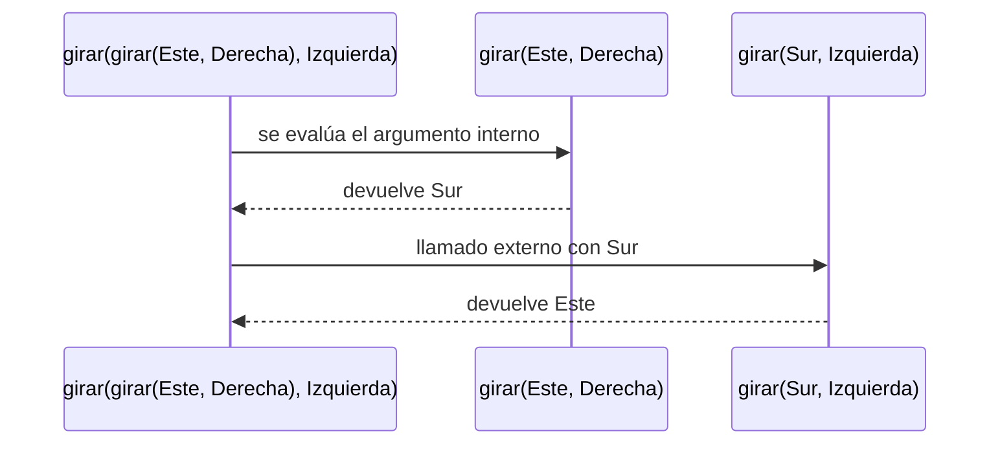
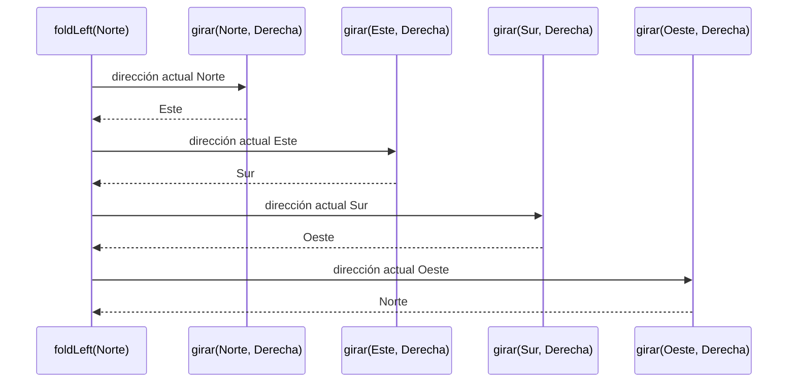

# Informe de proceso — Punto 1: `girar`

## Definición de la función

```scala
def girar(d: Direccion, s: Sentido): Direccion = (d, s) match {
  case (Norte, Derecha)   => Este
  case (Norte, Izquierda) => Oeste
  case (Oeste, Derecha)   => Norte
  case (Oeste, Izquierda) => Sur
  case (Sur, Derecha)     => Oeste
  case (Sur, Izquierda)   => Este
  case (Este, Derecha)    => Sur
  case (Este, Izquierda)  => Norte
}
```

* La función recibe la dirección a la que mira el robot (`d`) y el sentido del
  giro (`s`), y devuelve la nueva dirección.
* Arma la pareja `(d, s)` y la compara con los casos del `match`.
* Scala revisa los casos **de arriba hacia abajo** y se queda con el primero
  que coincide. Como hay un caso por cada una de las 8 parejas posibles,
  siempre encuentra uno.
* No es recursiva: no se llama a sí misma, así que cada llamado ocupa un solo
  marco en la pila y termina enseguida.

---

## Ejemplo 1: `girar(Norte, Derecha)`

### Paso 1: Llamada inicial

```scala
girar(Norte, Derecha)
```

### Paso 2: Se arma la pareja

```scala
(Norte, Derecha) match { ... }
```

### Paso 3: Se revisan los casos

```scala
case (Norte, Derecha) => Este   // coincide en el primer caso
```

### Paso 4: Resultado

```scala
Este
```

---

## Ejemplo 2: `girar(Sur, Izquierda)`

Este ejemplo muestra cómo el `match` va descartando casos hasta encontrar el
que coincide.

| Caso revisado | ¿Coincide con `(Sur, Izquierda)`? |
|---|---|
| `(Norte, Derecha)`   | no |
| `(Norte, Izquierda)` | no |
| `(Oeste, Derecha)`   | no |
| `(Oeste, Izquierda)` | no |
| `(Sur, Derecha)`     | no |
| `(Sur, Izquierda)`   | **sí → `Este`** |

```scala
girar(Sur, Izquierda)  // = Este
```

---

## Ejemplo 3: un giro y su contrario

```scala
girar(girar(Este, Derecha), Izquierda)
```

Scala evalúa primero los argumentos, así que se resuelve el llamado de
adentro antes que el de afuera.

### Paso 1: Llamado interno

```scala
girar(Este, Derecha)        // coincide con (Este, Derecha) => Sur
```

### Paso 2: Se sustituye el resultado

```scala
girar(Sur, Izquierda)
```

### Paso 3: Llamado externo

```scala
girar(Sur, Izquierda)       // coincide con (Sur, Izquierda) => Este
```

### Paso 4: Resultado

```scala
Este
```

El robot queda mirando a donde empezó.



---

## Ejemplo 4: cuatro giros a la derecha

```scala
List(Derecha, Derecha, Derecha, Derecha)
  .foldLeft(Norte: Direccion)((d, s) => girar(d, s))
```

`foldLeft` arranca con `Norte` y le aplica `girar` con cada elemento de la
lista, usando el resultado anterior como nueva dirección.

| Paso | Llamado | Resultado |
|---|---|---|
| 1 | `girar(Norte, Derecha)` | `Este` |
| 2 | `girar(Este, Derecha)`  | `Sur` |
| 3 | `girar(Sur, Derecha)`   | `Oeste` |
| 4 | `girar(Oeste, Derecha)` | `Norte` |

Después de cuatro giros el robot vuelve a mirar al norte.



Cada llamado a `girar` termina antes de que empiece el siguiente, así que la
pila nunca tiene más de un llamado de `girar` a la vez.
